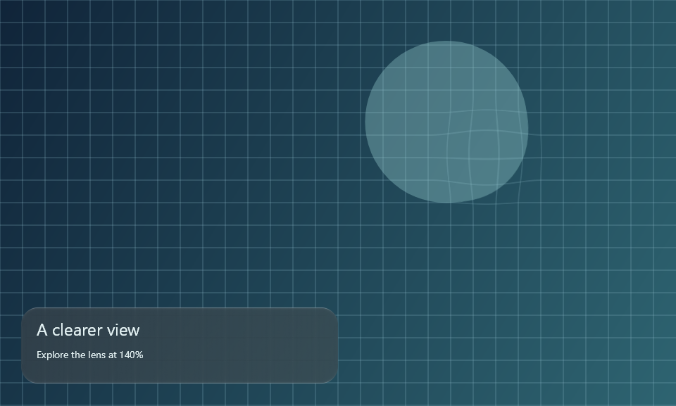

# LiquidGlass for .NET / SkiaSharp

Draw the production LiquidGlass shaders on an `SKCanvas`, without Compose, JavaScript or a browser.
`GlassPainter` owns shader compilation, uniform binding and the cached wide blur. Your application
owns the canvas, layout, input, accessibility and the pixels behind the glass.

This is an experimental adapter. It is packaged as `LiquidGlass` (the painter, .NET 8) and
`LiquidGlass.WinForms` (the Windows Forms host, .NET 10); CI packs both on every change and checks
their contents (`check-packages.mjs`). Released on NuGet from 0.2.1. The renderer targets
.NET 8; the runnable Windows Forms example targets .NET 10 / Windows 10 build 19041 or newer.
SkiaSharp is pinned to 4.153.1, with dependency locks in each project.



## Run it

From the repository root, install a .NET SDK and the .NET 8 runtime for the renderer checks.
The desktop example additionally needs the .NET 10 SDK and Windows Desktop runtime.

```sh
dotnet restore ports/dotnet/Checks/Checks.csproj --locked-mode
dotnet build ports/dotnet/Checks/Checks.csproj --no-restore
dotnet ports/dotnet/Checks/bin/Debug/net8.0/Checks.dll ports/dotnet/artifacts
```

The executable writes `verification.json` and example PNGs, and exits nonzero on failure. It compares
all four material profiles against independent JVM RGBA fixtures, compiles all three production
passes, and checks source mapping, ownership, cache invalidation and failed host recording.
Linux native assets are included in the checks project. Install `libfontconfig1` and a font such as
`fonts-dejavu-core` on Ubuntu to render the example's labels. Windows/Linux jobs run these checks in CI;
consult their result for the revision being used.

On Windows, run the interactive example:

```sh
dotnet restore ports/dotnet/WinFormsDemo/WinFormsDemo.csproj --locked-mode
dotnet run --project ports/dotnet/WinFormsDemo --no-restore
```

Drag the lens, use arrow keys to move it, and use plus/minus to change magnification. Native checkboxes
control dark glass, reduced transparency and contrast. Resizing rebuilds the backdrop and cancels a
drag. Hold and pull the card for calm material feedback; its labels and hit bounds stay anchored.
The Reduce motion checkbox cancels feedback immediately. `-- --capture <directory>` saves nine app-owned canvas snapshots and a host verification report,
then exits. Capture replay invokes the control's own mouse handlers; it never reads other windows
or moves the OS cursor. These phase images do not establish continuous timing or presented FPS.

On the maintainer's Windows checkout, `tools/dotnet-port.ps1` selects the private SDK and cache.
Build with that wrapper, then execute the DLL with the system `dotnet` when its runtime is needed.

## Add glass to a host

`dotnet add package LiquidGlass` (and `LiquidGlass.WinForms`, `LiquidGlass.Wpf`, `LiquidGlass.Avalonia` or `LiquidGlass.Maui` for a host), or reference `LiquidGlass.Skia/LiquidGlass.Skia.csproj` from a checkout. Keep `ports/skia/shaders`
alongside it: the build embeds those production exports. The built DLL does not fetch shader files
at runtime. For a Linux host, add the matching `SkiaSharp.NativeAssets.Linux` package and install
fontconfig/fonts. The dependency-free variant has no system font provider; a host using it must
supply its own font files when drawing text. Other platforms need their matching native assets.

```csharp
using LiquidGlass.Skia;
using SkiaSharp;

// Keep one painter per rendering thread/context, not one per frame or widget.
using var glass = new GlassPainter();
glass.SetSource(backdropImage); // borrowed opaque sRGB SKImage

// Draw the ordinary page first. Bounds are in backdrop/device pixels.
glass.DrawLens(canvas, SKRect.Create(360, 50, 180, 180), magnification: 1.4f);
glass.DrawSurface(canvas, SKRect.Create(30, 260, 300, 100), radius: 24,
    options: new(Dark: true, TintAmount: 50, Density: 1));
// Draw ordinary labels afterward; they keep their host layout and semantics.
```

The complete [Windows Forms host](WinFormsDemo/Program.cs) demonstrates one captured page shared
by a lens and a card. Its `SKControl` uses CPU Skia rendering. Move this painter into an existing
Skia draw callback to integrate it; adding a reference alone does not capture arbitrary UI widgets.

If your page already draws through Skia, the painter can own the snapshot:

```csharp
glass.RecordBackdrop(width, height, pageCanvas => DrawPage(pageCanvas), SKColors.Black);
// In the host's paint callback:
DrawPage(canvas);
glass.DrawSurface(canvas, cardBounds, 24, new(Dark: true));
```

Record again when the page changes, not when only a glass control moves. Exclude glass and overlays
from `DrawPage` to avoid recursive feedback. A failed recording leaves the preceding source usable.
This API records your drawing callback; it does not capture WinForms/WPF/MAUI/Avalonia widgets.

### Use existing Windows Forms controls as the backdrop

Reference `LiquidGlass.WinForms/LiquidGlass.WinForms.csproj` for the Windows-specific adapter
(.NET10/Windows10). On your UI thread, after handles and layout exist:

```csharp
using LiquidGlass.WinForms;

// backdropPanel contains ordinary controls only; put glass overlays outside that subtree.
SKImage next = ControlBackdrop.Capture(backdropPanel, backdropPanel.BackColor);
try { glass.SetSource(next); }
catch { next.Dispose(); throw; }
SKImage? previous = currentBackdrop;
currentBackdrop = next;
previous?.Dispose();
// Dispose currentBackdrop after the painter no longer borrows it.
```

This renders the specified control and its children through `Control.DrawToBitmap`. It never
reads the desktop or another process. The output is opaque, with its origin at the control's
outer top-left, including its border. Dimensions and renderer bounds are device pixels. Refresh
after relevant content/layout changes; coalesce invalidations rather than capture every animated
glass frame. This is CPU bitmap work and requires an intermediate GDI bitmap and Skia image.

The returned image is caller-owned; a failed capture leaves your previous snapshot untouched.
The source must be visible and have a handle, and the call must run on its owning UI thread.
An opaque background is required. Known unsupported RichTextBox/ActiveX subtrees throw instead
of returning an apparently successful incomplete image. Hidden children are omitted. Overlapping
container order and custom/native controls need host validation; this is not a universal widget
capture guarantee. See [Microsoft's DrawToBitmap limitations](https://learn.microsoft.com/en-us/dotnet/api/system.windows.forms.control.drawtobitmap?view=windowsdesktop-10.0).

Try the executable example with editable native controls beside their glass preview:

```sh
dotnet run --project ports/dotnet/WinFormsDemo --no-restore -- --controls
dotnet ports/dotnet/WinFormsDemo/bin/Debug/net10.0-windows10.0.19041.0/WinFormsDemo.dll --controls --capture controls-proof
```

The second command verifies actual TextBox glyph changes, identity/refraction pixels, retained
source after rejection, thread ownership and resizing, then exits. Windows CI runs it; Linux
continues to run the framework-independent painter/controller checks. [Native-control evidence](../../review/atlas/dotnet-controls-2026-10-13/README.md).

### Use existing WPF content as the backdrop

Reference `LiquidGlass.Wpf/LiquidGlass.Wpf.csproj` (.NET 10, Windows 10 19041+; package `LiquidGlass.Wpf`
once released). `VisualBackdrop.Capture` renders your own WPF subtree into an opaque Skia image, and
`GlassBitmap` is a `WriteableBitmap` the painter draws into. Show it with an `Image` between the
backdrop and the labels that sit on the glass, so the labels stay ordinary WPF elements:

```csharp
using LiquidGlass.Skia;
using LiquidGlass.Wpf;

// backdrop holds ordinary content only; the Image and the labels sit outside it, above it.
var scale = VisualTreeHelper.GetDpi(window).DpiScaleX;
var source = VisualBackdrop.Capture(backdrop, Colors.White, scale);
painter.SetSource(source);                       // keep `source` alive while the painter uses it
var glass = new GlassBitmap(source.Width, source.Height, scale);
glassImage.Source = glass.Bitmap;                // <Image Stretch="None"/> over the backdrop
glass.Render(canvas => painter.DrawSurface(canvas, SKRect.Create(40 * (float)scale, 330 * (float)scale,
    360 * (float)scale, 120 * (float)scale), 28 * (float)scale, new(Density: (float)scale)));
```

Capture again after the backdrop's content or layout changes, not when only the glass moves. The
[WPF host](WpfDemo/Program.cs) shows a page of WPF text, a button and colour bands with a glass card
and a lens you drag. `--capture DIR` lays it out without a window, renders it, checks the pixels and
saves `wpf-glass.png`; CI runs that on Windows. [Evidence](../../review/atlas/wpf-2026-10-19/README.md).

### Use existing Avalonia content as the backdrop

Reference `LiquidGlass.Avalonia/LiquidGlass.Avalonia.csproj` (.NET 8; Windows, macOS and Linux; package
`LiquidGlass.Avalonia` once released). It is the WPF adapter's shape. `VisualBackdrop.Capture` renders
your own Avalonia subtree into an opaque Skia image, in whichever channel order the platform uses.
`GlassBitmap` is a `WriteableBitmap` the painter draws into, shown with an `Image` under ordinary
Avalonia labels:

```csharp
using LiquidGlass.Avalonia;
using LiquidGlass.Skia;

var source = VisualBackdrop.Capture(backdrop, new SKColor(246, 243, 248), topLevel.RenderScaling);
painter.SetSource(source);                       // keep `source` alive while the painter uses it
var glass = new GlassBitmap(source.Width, source.Height, topLevel.RenderScaling);
glassImage.Source = glass.Bitmap;                // <Image Stretch="None"/> over the backdrop
glass.Render(canvas => painter.DrawSurface(canvas, cardRectInDevicePixels, 28, new(Density: (float)topLevel.RenderScaling)));
```

Avalonia 12 is built on SkiaSharp 3.119 and accepts the painter's SkiaSharp 4.153.1 in the same
process; the [Avalonia host](AvaloniaDemo/Program.cs) runs headlessly with Avalonia's Skia renderer,
draws a glass card and a lens over Avalonia content, checks the pixels and saves
`avalonia-glass.png`. CI runs it on Linux and Windows. [Evidence](../../review/atlas/avalonia-2026-10-19/README.md).

### .NET MAUI: glass over your own MAUI views

Reference `LiquidGlass.Maui` (package `LiquidGlass.Maui`; .NET 10, Android and Windows; iOS and Mac
Catalyst are not targets). `GlassSurface` is a `ContentView`: its glass is drawn by the painter through
`SkiaSharp.Views.Maui`, and its `Content` stays ordinary MAUI views with their layout, input and
accessibility. `GlassBackdrop` captures one of your elements (a page's content, a ScrollView's
content) from its native view: Android's `View.Draw` into a bitmap, WinUI's `RenderTargetBitmap`.
It captures by itself once the element is drawn, and again when its size changes; call
`RefreshAsync()` after its content changes. Glass follows the element as it scrolls, with no new
capture.

```csharp
// MauiProgram.cs
builder.UseMauiApp<App>().UseLiquidGlass();

// A page: rows in a ScrollView, glass over them in the same Grid.
var backdrop = new GlassBackdrop(rows, BackgroundColor);   // rows = the ScrollView's content
var bar = new GlassSurface
{
    Backdrop = backdrop, Dark = true, Radius = 36, HeightRequest = 72,
    VerticalOptions = LayoutOptions.End, Margin = new Thickness(20, 0, 20, 28),
    Content = tabs,                                         // ordinary MAUI views on the glass
};
Content = new Grid { Children = { new ScrollView { Content = rows }, bar } };
```

Keep every `GlassSurface` outside the element its backdrop captures. `Padding` insets the content
only; the glass fills the surface. The backdrop is a snapshot: content that animates on its own (a
video, a spinner) shows its state at the last capture. MAUI's own `CaptureAsync` is not used on
Android: there it copies the window's pixels over the element's bounds, overlays included, so the glass
refracted itself in the first device run.

The [MAUI demo](MauiDemo/MauiProgram.cs) (`net10.0-android`) is a light glass card and a dark glass bar
over 24 rows of native MAUI views. It runs on a Pixel 7; CI builds the library for all three targets
and the demo's APK on Windows, packs `LiquidGlass.Maui` and checks it ships no iOS assets.
[Evidence](../../review/atlas/maui-2026-10-20/README.md).

```sh
dotnet workload install maui-android
dotnet build ports/dotnet/MauiDemo -c Release
adb install -r ports/dotnet/MauiDemo/bin/Release/net10.0-android/dev.shayxo.liquidglass.mauidemo-Signed.apk
```

## Navigation: the Calm selector

`CalmNavigation` runs the Compose `GlassTabBar` gesture protocol over `CalmSelectorController`, a
line-by-line port of the Compose pose controller checked against the Kotlin-exported trajectories in
`ports/skia/fixtures/selector-calm.json` (worst 0.035 px over 456 frames). Feed bar-local pixels and
monotonic seconds; draw the body with `GlassPainter.DrawSelector` after the bar:

```csharp
var bar = CalmSelectorBar.Create(width: 300, height: 62, count: 3);
var nav = new CalmNavigation(bar, selected: 0, onSelect: index => Route(index));
nav.Down(x, y, seconds); nav.Move(x, y, seconds); nav.Up(x, y, seconds);
if (nav.Frame(seconds)) RequestRedraw();
var c = nav.Controller; var options = new GlassSurfaceOptions(Dark: true, Density: 1);
painter.DrawCalmBar(canvas, barRect, (float)c.Formation, options, (float)nav.Touch);   // Touch: the bar's lift for any touch
using var through = surface.Snapshot();   // the page with the bar's glass over it
painter.DrawSelector(canvas, barRect, c.Render(), (float)c.Formation, options,
    (float)c.TransitAppearance, (float)c.HeldTravel, through);
```

`CalmSelectorBar.Create(..., slotWidth: px)` lays the tabs on equal slots of that width centred
in the bar, as Compose's `GlassTabBarStyle.slotWidth` does: the end tabs close up until their pill
sits `pillInset` inside the bar's end. Draw your items at `bar.CentreOf(i)`; `NearestTab` maps a
bar-local x to a tab.

`DrawCalmBar(..., clear: true)` (and `CalmSelectorMaterial.Bar(..., clear: true)`) draws Compose's
`GlassTabBarStyle.CalmClear()` bar: the clearer glass of WhatsApp's and the App Store's dark iOS
bars: the dark bar is the measured in-app material with Calm's bar-only fields (18 November, #203), light
appearance unchanged. The previous preset, before 18 November, was black at 0.10, legibility 2 and a 7 dp blur.

`DrawSelector` follows Compose's held lens fully (18 October): its rim band is the material's
`bodyBandScale` share of the body's own (0.3 in Calm), and light Calm's lens casts its contact shadow
(`shadow: false` skips it). `AccessoryFuse.LensFuse(barWidth, barHeight, button, formation, lensFusion)`
gives `DrawSelector(..., fuse:)` a held lens's own neck to the free button (Compose's
`GlassTabBarAccessory.lensFusion`), null until the lens has formed. `CalmNavigation.ItemFollow` is how much of
a press transform the host applies to the bar its items should share: 0 on a tap, 1 once a hold has formed
the lens. Blurs follow Compose's radius-to-sigma conversion (`0.577 r + 0.5`).

A free button beside the bar (Compose's `GlassTabBarAccessory.link`) fuses with it:
`AccessoryFuse.Compute(barWidth, barHeight, new RectD(x, y, w, h), button.Sample(t), smoothing, barPressX,
barPressY)` gives `DrawCalmBar(..., fuse:)` the rect the bar's outline reaches for; scale `smoothing` by
`1 - AccessoryFuse.Yield(formation, lensEdge, barWidth, barHeight)` as a lens arrives. Checked against the
Kotlin-exported `accessory-fuse.json`.

`DrawCalmBar` and `DrawSelector` use the Compose Calm bar and selector material itself
(`CalmSelectorMaterial`: the production styles exported by the Kotlin tests, blended by the same
rules and checked against 96 Kotlin-computed uniform sets). Pass `through` so the lens looks through
the bar as in Compose; without it the lens sees the page alone. For the selected ink, draw your items
in their selected appearance into an image at the bar's origin and pass it to
`DrawSelectorInk(canvas, barRect, c.Render(), ink, ...)` after `DrawSelector`: it shows only under the
selector, through the production content pass. Labels, accessibility and the WinForms control wiring
stay with the host.

### Render a frame at any time

`CalmNavigation` only moves forward in time, so a frame at `t = 3.2 s` of a gesture would otherwise mean replaying it from zero.
Bake the gesture once, then ask for any moment, in any order or from any thread:

```csharp
var bar = CalmSelectorBar.Create(width: 300, height: 62, count: 3);
var events = new List<NavigationEvent> {   // bar-local px and seconds, as CalmNavigation takes them
    new(NavigationEventType.Down, 0.5, 60, 31), new(NavigationEventType.Move, 1.2, 60, 31),
    new(NavigationEventType.Move, 1.6, 180, 31), new(NavigationEventType.Up, 1.9, 180, 31) };
var track = NavigationBaker.Bake(bar, events, duration: 4);          // steps 1/240 s: CalmNavigation + CalmInteraction
NavigationSample s = track.Sample(3.2);
painter.DrawCalmBar(canvas, barRect, (float)s.Formation, options, (float)s.Touch);   // press feedback: s.Feedback
painter.DrawSelector(canvas, barRect, s.Pose, (float)s.Formation, options, (float)s.TransitAppearance, (float)s.HeldTravel, through);
var data = track.ToData();  // plain numbers: serialize it, then NavigationTrack.FromData(data) elsewhere
```

The bake steps the motion, never jumps; a selection a gesture commits is applied as an `onSelect` handler would. `Sample` is exact
at a step and interpolates linearly between steps (the pose's inverse is recomputed; `Held`, `TapFormed`, `Hold.Formed`, `Hold.Releasing`, `Selected` and `Active`
keep the earlier step's value), and clamps before 0 and after the last step. A live run at another frame cadence differs
slightly, as any two live runs do. Tracks saved at version 1 (before the hold terms) still load and play as they did. The painter's draw methods are already stateless, so there is no separate draw call.

## Geometry, options and lifetime

### Calm press and pull

`CalmInteraction` supplies a reusable controller for whole cards, bars and other surfaces. It
uses the same authored response as the portable controller, with cross-language trajectory
checks. It is not navigation-selector travel (see below) and claims no complete iOS timing parity.
Construct it once per surface; pass **logical pixels** and **monotonic seconds**, not milliseconds:

```csharp
var motion = new CalmInteraction(new CalmGeometry(
    Width: 300, Height: 100, Radius: 24, X: 40, Y: 70,
    ViewportWidth: 800, ViewportHeight: 600));

// Input callbacks: dx/dy are TOTAL displacement since this pointer went down.
motion.Press(seconds, dx, dy);
motion.Release(seconds); // pointer-up, cancellation or lost pointer capture

// Paint callback: sample once; schedule another frame only while Active is true.
GlassFeedback feedback = motion.Sample(seconds);
glass.DrawSurface(canvas, devicePixelBounds, 24 * density,
    new GlassSurfaceOptions(Dark: true, Density: density), feedback);
// Draw labels afterward using their original bounds.
```

`GlassFeedback` is an immutable value containing a centre-based2×2 matrix, logical-pixel offset,
press amount, held state and whether another animation frame is needed. The painter applies it
only while drawing the material and restores the canvas. It transforms the material's sampled
backdrop with that drawing, matching the portable scene contract; it is not arbitrary native
widget refraction or an independent measurement of the original optics.

Keep layout, text, accessibility and hit testing at their original bounds. The host must own
one pointer, arbitrate with scrolling, and call `Release` when that pointer is cancelled. A
stationary held controller can become idle; a later move must request a frame again. A queued
`Sample` older than the latest input does not rewind state; out-of-order input events throw.
`Resize(newGeometry, seconds)` cancels the old gesture. `SetReducedMotion(value, seconds)`
clears deformation immediately and cancels gesture ownership; release the host's capture too.

Both viewport dimensions are optional together. When supplied and the original bounds fit,
the controller constrains the complete rounded outline to that viewport. Partly offscreen
surfaces keep their authored shape; the host still owns clipping. Options allow per-edge press
growth and `GlassPullShape.AreaPreserving` for whole-bar feedback. Defaults remain adaptive
with3% maximum press growth and2logical pixels per edge. None of these parameters is a recovered
Apple implementation.

The [native motion evidence](../../review/atlas/dotnet-calm-2026-10-13/README.md) includes144
cross-language states,107,520independent outline probes, frame-rate checks, real shader pixel
checks and nine native host phases. Regenerate/check portable fixtures with:

```sh
node ports/dotnet/generate-motion-fixtures.mjs
node ports/dotnet/generate-motion-fixtures.mjs --check
```

CI checks fixture freshness and runs the native checks on Windows and Linux. Native host
capture remains Windows-specific; GPU and other host frameworks remain unverified.

| API / option | Contract |
| --- | --- |
| `SetSource(image)` | Borrows a live opaque sRGB image; caller keeps it alive until replacement/disposal. Never disposed by the painter. |
| `RecordBackdrop(...)` | Owns the new opaque snapshot. Replacing it or disposing the painter releases it. |
| `DrawLens(..., magnification)` | Continuous lens, 1–2.5 magnification, with the Compose clear-lens preset (`GlassStyle.clearLens`) by default: rim highlight, a thin white tint and a contact shadow, so it reads as glass over flat content. Authored in Compose, not an iOS measurement. |
| `DrawLens(..., new GlassLensOptions(Lighting, Shadow, Density, LightX, LightY), magnification)` | `Lighting: false` is the bare magnification map (at magnification 1 pixel-identical to the source, the lens before 1.1.0); `Shadow` false skips the contact shadow; `Density` is px per dp; `LightX`/`LightY` point toward the light. |
| `NavigationBaker.Bake(bar, events, duration, step)` | Runs a scripted gesture through `CalmNavigation` and the bar's `CalmInteraction` at a fixed step (default 1/240 s) and keeps every step; `track.Sample(t)` is the bar's state at any time, in any order, for `DrawCalmBar` / `DrawSelector`. See below. |
| `DrawSurface(..., radius)` | Rounded in-app material; one radius or four values in top-left, top-right, bottom-right, bottom-left order. |
| `Dark`, `TintAmount` | Default false / 50; tint is 0–100 and follows the production in-app calibration. |
| `Density` | Default 1; scales dp material constants. Bounds and radii remain physical pixels. |
| `Materialize` | Default 1, range 0–1. This is appearance, not a gesture controller. |
| `ReducedTransparency`, `IncreasedContrast` | Default 0, range 0–1; supply current host preferences. |
| `Dispose()` | Releases owned images, paint and compiled material. Idempotent; later use throws. |
| `DrawSurface(..., feedback)` | Optional calm material transform; controller offsets are logical pixels, scaled by `Density`. The default preserves existing pixels. |

Draw in the backdrop's coordinate system, with a top-left origin and matching pixel density. Use
an identity canvas matrix for device-pixel bounds; do not apply a logical-pixel scale a second time.
Canvas save/restore and paint state are preserved. Image edges clamp, including partly offscreen
surfaces. Radius and geometry must be finite and valid. Source colour space is the host's contract;
the adapter checks opacity but does not convert wide-gamut/HDR content into sRGB.

The wide tone image is cached per source and blur density. It has roughly 1/16 the source's pixel
area; a rebuild also needs a temporary surface. An owned recorded backdrop costs about four bytes
per pixel, before allocator/backend overhead. The CPU blur path is not a GPU performance claim.
Use/dispose each instance on its owning rendering thread. Recreate it and its source after context
loss if your host uses GPU-backed images.

### A free button (the Phone search button)

`FreeButton` is Compose's `GlassInteraction.Pullable` with `GlassPullShape.Free`: `Down(t)`,
`Move(t, dx, dy)` (total travel since down) and `Up(t)` in seconds, then `Sample(t)` gives the press
scale, the stretch along and across `Angle` (degrees), the offset and the lift to draw the button with.
The checks replay the Kotlin-exported `free-button.json` frame by frame. The bar's outline does not
follow it here.

It is also the default interactive response, `GlassInteraction.Fluid`, which falls with size (authored): pass `width`,
`height` and `radius` (px). A control of 80 dp or less on its long side is the search button; from 160 dp it presses 2 dp
a side, never leaves its place and stretches at most 2 dp; between the two it blends. `Cancel(t)` is for a scroll that
takes the gesture: everything returns critically damped with no ring. `free-button-sizes.json` checks a circle, a pill
and a card.

## Lower-level passes and remaining gaps

`GlassEffectPass("material" | "content" | "endpoint")` exposes the same evaluated SkSL as Kotlin
and CanvasKit. `CreateUniforms()` returns fresh zero values. `CreateShader(values, children)` requires
every declared finite scalar/vector and live shader child; it rejects missing/unknown names and
returns a shader that the caller owns. `GlassPainter.ClearUniforms(...)` provides a clear-lens setup.
Follow the [compositing contract](../../docs/porting.md#combining-refracted-ink-with-glass) for custom
foreground/path effects. These low-level passes do not construct those layers for you.

Verified locally: Windows CPU rendering, the interactive Windows Forms host, four source profiles,
shared-source lens/card drawing and lifecycle checks. [Evidence and exact scope](../../review/atlas/dotnet-2026-10-10/README.md).
Windows/Linux renderer checks and Windows host compilation are in CI. macOS, GPU hosts, Android/iOS
SkiaSharp views and MAUI have not received native host verification here. WPF is verified offscreen
in CI (`WpfDemo --capture`), and Avalonia 12 headlessly on Linux and Windows (`AvaloniaDemo`).
Avalonia 11, on SkiaSharp 2.88, cannot load this painter's SkiaSharp 4; use Avalonia 12. SwiftUI,
Flutter, React Native, Qt and Unity still need their own integration. Whole-surface calm interaction
is supplied, and so are the Calm navigation-selector dynamics (`CalmSelectorController`,
`CalmNavigation`, `GlassPainter.DrawSelector`); portable refracted foreground is not supplied by
this painter. The separate WinForms adapter captures verified standard controls; automatic
arbitrary-widget capture across frameworks remains incomplete.
The full any-stack and iOS-parity goals remain open.

The adapter is Apache-2.0; see [LICENSE](../../LICENSE) and [NOTICE](../../NOTICE). SkiaSharp is MIT
and includes native third-party components. Preserve the NuGet packages' `LICENSE.txt` and
`THIRD-PARTY-NOTICES.txt` when distributing binaries. Do not edit generated SkSL here; regenerate it
from the Kotlin production source using the [shader export workflow](../skia/README.md#regenerate-do-not-hand-edit).
