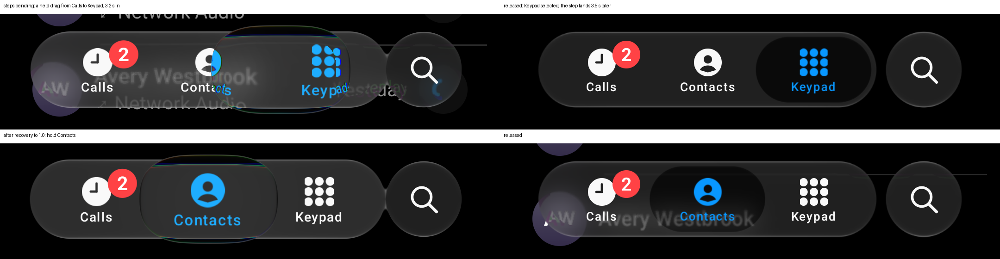

# Adaptive quality (#118) — 2 November 2026

Our frames only: Pixel 7 (Android 17, 90 Hz), release build of the sample's `PhoneActivity` with `--ez adaptive true`,
captured 2 November 2026 with `adb exec-out screencap` during `input swipe` gestures; crop y 2080-2330. Steps were read
from logcat (tag `GlassAdaptive`, the sample's `LiquidGlassDiagnostics.adaptiveQualityListener`).

## What was checked on the phone

**At the real deadlines nothing steps.** Adaptive on, 16 taps alternating Contacts and Keypad: no step. On this phone
each tap misses one deadline, its first frame, while the GPU clock rises from idle (#100); the governor needs more than
a quarter of a second's frames late.

**Forced misses step down and back up.** With `--ef adaptiveDeadlineScale 0.3` (a diagnostic: a frame counts as missed
past 0.3 of its deadline, so every tap frame does), taps stepped the factor 0.75 → 0.5625 → 0.5 about a second apart.
About 3 s after the last tap it stepped back 0.5625 → 0.75 → 1.0, 3.5 s apart, retracing the way down.

**A step never lands under a finger.** The first build applied a step at once. A step rebuilds the theme's glass, and a
rebuild during a hold cancelled it: the lens did not form and the release selected nothing. Steps now wait until no
frame has been drawn for 300 ms. Above: with misses forced throughout, a 4 s held drag from Calls to Keypad keeps its lens
and selects Keypad on release; the pending step (0.75) landed 3.5 s after the release, once the settle had finished.
After recovering to 1.0 a hold forms the lens and releases normally.

**Idle stays idle.** With the factor lowered, 2 s windows read 0 frames except the 4 frames each step's rebuild draws.
Adaptive off, after the same taps: 0.

## Limits

- Android only. The desktop and web keep their `renderScale`: they have no per-frame deadline to read without
  requesting frames.
- The thresholds (a quarter of a second's frames, 3 s to recover, ×0.75 per step, floor 0.5) are authored, not fitted;
  the phone only showed they do not fire on its own taps. A device that misses steadily is where they will be tuned.
- The forced run shows the mechanism, not a slow phone: `adaptiveDeadlineScale` is a diagnostic.
