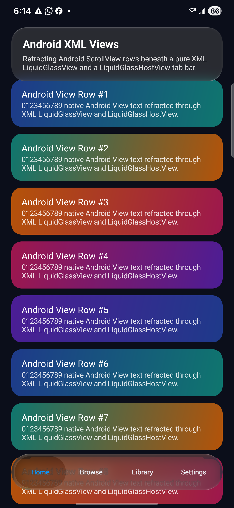

# Android XML interop takeover — 29 October 2026

Implemented locally on `codex/xml-interop-takeover`, based on PR #127 at `1fb561cffda149d3e46bff9adf27d139eec1dbb3`. The verified changes are being committed for Claude's review; this is not a merged release. Exact source-file and installed APK hashes are in [working-tree-identity.json](working-tree-identity.json).

## Changes

- Interactive native effects consume decorative-view gestures through their listener without mutating application clickability. An app click listener installed after glass remains functional after disable/dispose.
- Drawable opacity applies once to the completed native source plus fallback overlay, preserving optical strength and correct premultiplied blending on older Android.
- Regressions cover real parent-dispatched clicks, intermediate hardware/software opacity, restored unpressed pixels and native/Compose rendering against the same striped source.
- An opt-in `-Psample.qualification=true` uses a separate sample package; the existing installed sample and its data remain intact.
- The contributor's old physical evidence is labelled historical and separated from later emulator results.

## Executed checks

| Check | Result | Scope |
| --- | --- | --- |
| Full `:liquidglass:jvmTest --rerun` | 92 suites, 438 tests: 411 passed, 27 skipped, 0 failures/errors; 27m 1s | Shared rendering, geometry, gesture and reference regressions |
| Android app/test assemble and `:liquidglass:checkKotlinAbi` | Passed | Qualification build; no public ABI change |
| Physical Samsung S24+, API 36 | 37/37 passed, 27.421 s | Full Android interop suite, including new regressions |
| API 32 emulator | 3/3 passed, 4.278 s | Half-opacity fallback and both clickability regressions |
| API 28 emulator | 3/3 passed, 10.4 s | Pre-RenderNode fallback and both clickability regressions |
| Native vs Compose Regular interior | RGB MAE 0.416597/255, 28,800 samples; limit 3 | Same hardware window, striped source, rounded shape; excludes outer shadow |
| Original calibration targets | 24/24 matching historical output images pixel-identical | `GlassCalibrationRenderTest`, light/dark targets and tint variants |
| Strict MkDocs / repository links / whitespace | Passed | 159 tracked documentation links; final docs checked separately |

### Negative controls

The tests were also run with the two production files restored to PR head before the fixes. The app-click-after-install test failed on the physical S24+. The API 32 opacity test failed with channel 155 versus the expected 218 at half alpha. After restoring the fixes, both pass. Full logs are in [logs/](logs/).

### Physical captures



*S24+ / Android 16 API 36 / AGSL; working-tree source hashes and APK identity in the manifest above; captured with adb screencap after launching the isolated XmlInteropActivity. A still capture proves this scene only, not frame-time performance.*

[Native parity frame](parity-native.png) and [Compose parity frame](parity-compose.png) were captured via successful hardware PixelCopy in the same test. The opaque green barrier separates sampled source pixels from the visible underlay. The comparison uses the panel interior; it does not establish outer-shadow or all-preset parity.

## Reproduce

Use JDK 21 and the repository's `tools/workspace.ps1 library` wrapper. Build `:sample:assembleDebug :sample:assembleDebugAndroidTest :liquidglass:checkKotlinAbi -Psample.qualification=true`. Install both APKs, then run:

```text
adb -s DEVICE shell am instrument -w -r -e class com.wexpa.liquidglass.sample.GlassBackdropHardwareTest com.wexpa.liquidglass.sample.qualification.test/androidx.test.runner.AndroidJUnitRunner
```

For API 28/32, run only `drawableAlphaControlsCompositingOpacityOnHardwareWindow`, `applicationClickInstalledAfterGlassSurvivesDisableAndDispose` and `clickabilityRestoredOnDisablingInteractionAndDisposal`. Refraction-specific tests intentionally target AGSL-capable devices.

## Limits and retained diagnostics

The local dataset remains private. Calibration sources came from `research/datasets/calibration-targets`; outputs matched the historical `phase3/render_legacy/library` set exactly. This is a calibration regression result, not a claim that every iOS recording matches.

### Completed motion comparison

Fresh merge-base (`0cbd5e2`) and candidate renders used identical complete input files, variants, Direct3D backend and 60 Hz virtual clock:

| Dataset sequence | Frames per build | Byte-identical frames | Trace differences |
| --- | ---: | ---: | ---: |
| docs2, 35.87 s | 2,153 | 2,153 | 0 |
| IMG_6756 Search, 34 s | 2,041 | 2,041 | 0 |
| Total | 4,194 | 4,194 | 0 |

All columns match exactly: selector position, body width, held state, formation, protrusion, drag index, transit and held travel. Complete-frame equality establishes no shared-renderer motion or pixel regression for these sequences. This supersedes the earlier three-second diagnostics against saved n6 outputs whose inputs/timing were not comparable.

Reproduce comparisons with `python tools/compare_motion_replays.py BASE_OUTPUT CANDIDATE_OUTPUT --output result.json`. The command checks contiguous frame sets and complete traces, then fails on pixel or trace changes. Positive and negative controls accepted identical inputs and rejected a single changed pixel and a one-unit trace change. Source input hashes, run exit codes and results are under [motion/](motion/).

### Comparison to decoded iOS dataset

The existing reference measurement tools were executed against the fresh base outputs. The candidate frames are byte-identical, so the measurement results apply equally to both builds; no duplicate measurement or retuning is needed.

- docs2 held-rim displacement: iOS median 10.9 px vs library 10.8 px, gap 0.1 px (204 iOS / 219 library measured frames). Full bootstrap intervals and moving-state results: [docs2 measurement summary](motion/docs2-ios-summary.txt).
- Search, 1,605 measured frames: RMS centre x 1.7 px, centre y 2.3 px, height 4.0 px, half-width 2.5 px. The inherited brightness RMS gap is 16.5 on the 0–255 display-sRGB scale. [Per-episode results](motion/search-base-ios-summary.txt).

The brightness gap is an existing shared-material limitation, unchanged by XML support. These gesture scripts are inferred from recordings, not recorded touch traces. The comparisons qualify the two named complete sequences, not all devices, all presets or full iOS parity.

### Extended Android verification

The final physical suite additionally checks the decorated View, XML LiquidGlassView and Compose-host paths over one scrolling source, child-only source invalidation, returning scroll content and detach/reattach. An opaque green underlay prevents direct source visibility from satisfying the assertions. All 37 tests passed. The installed app remains the fixed isolated qualification package; its test APK and updated test-source hashes are recorded in the identity manifest.


The first multi-target build exhausted host native memory. A single-worker/in-process Kotlin build succeeded. Preview emulator 37 rejected older image layouts; an isolated official emulator 36.6.11 (verified archive SHA-256) ran API 28/32 without replacing the installed SDK emulator. The existing sample's signing key differed, so qualification used an isolated package and a consistent local debug key. Raw setup/build logs remain in `.local/takeover/logs`.

Qualification itself performed no remote push, merge, release or workflow approval. The owner subsequently authorized preparing and pushing these fixes for Claude's review. The primary checkout's unrelated dirty shader/appearance work was not changed.

## Claude review and merge checklist

- Review the maintainer clickability/opacity changes and the negative-control evidence.
- Confirm the final PR head contains the source hashes in the identity manifest (hashes
  describe the tested working-tree bytes; Git may normalize line endings).
- Require successful checks on the final PR head, including any maintainer workflow approval
  GitHub requires for a fork contribution.
- Retain the documented fallback, preset, outer-shadow and iOS brightness limitations.
- Merge only after Claude's independent review. No tag or release is part of this change.
