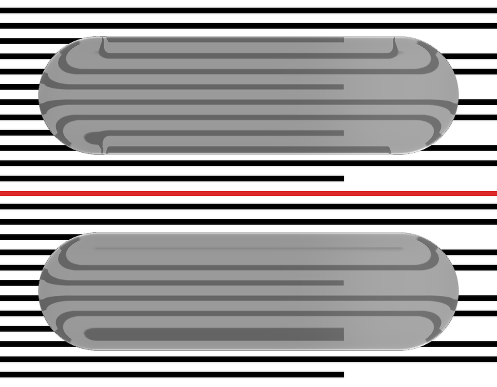
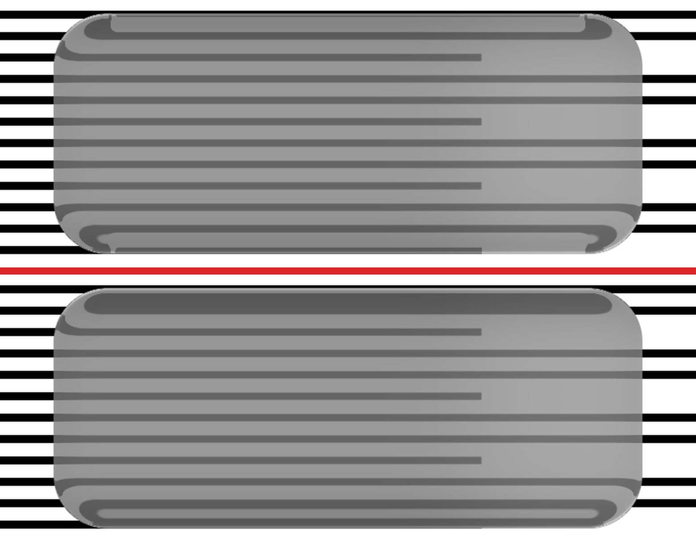

# Lines no longer hook where a capsule's round end begins — 17 November 2026

Source revision: branch `fix/cap-cut` on main `d7733bd2`. Backend: desktop JVM, Skia. The before/after images are a Compose
render of `Glass.Regular` (`glassEffect`, `LiquidGlassTheme`) at 3x over black 3 dp lines on white: a 220 x 62 dp capsule,
and a 220 x 90 dp card with 20 dp corners. "Before" is clean `origin/main` (`d7733bd2`); "after" is the branch. The same
render on main before #210 (`0e2f7a63`) shows the same hook, finer, so it is older than the measured material. The scores
below are against the 16 November Safari lab stills, which are private: only numbers appear here. Nothing here was
captured on an Android phone.

## The cause

At rest the measured profile lensed only the corner arcs: a straight run showed nearly what is under it
(`u + 0.06 (1-u)^2`), an arc showed the measured resting map (`GlassRestMap.Measured`), and `cornerWeight` blended the two
over 0.2 of the corner radius along the run. Near the rim the two maps show rows about 0.7 of the band apart, so a line
under the junction was dragged through those rows within a few pixels: a short vertical tick at each cap start, top and
bottom. Over flat grey the junction is clean (a source remap cannot draw on a flat backdrop), so nothing else contributes.

## What iOS shows

The Safari lab pill (R = 71.5 px, iPhone 13) over 24 px horizontal stripes: along the straight run the outer band is
displaced the same way at every column up to the cap start, and nothing changes where the round end begins. Stripe edges
in the run's outer band (rows below the pill's top): iOS 2297.5 and 2314.5; main 2302.5 and 2315.5 (5 px off); the
measured map run along the straight edge 2299.5 and 2313.5 (within 2 px). In the round end all three agree.

## What changed

Styles on the measured resting map (`Glass.Regular`, `GlassStyle.inApp`, `GlassStyle.toolbar`, custom styles with
`restMap = Measured`) now show that map all the way round the outline, straight runs included. The legacy map, which every
tab bar uses, keeps the corner-only lens and its 0.2 R blend; the docs/1 replay is unchanged frame for frame (0 of 1934
frames differ from main).

Scored on the lab stills (12, 24 and 48 px horizontal stripes, dark and light), luma rms against iOS in the outer 3-45 px
of the pill: the straight run 4.5-12.0 levels (main 12.0-25.6), the junction 13.0-16.5 (main 16.9-23.8), the round end
unchanged (13.6-19.1). `GlassCapJunctionTest` renders the map alone over a ramp: near each cap start the shown row moved
3.46 rows per pixel on main and 0.00 now; mid-run it now shows what the cap's tip shows at the same depth (1.0 rows; main
41).

*Our renders only. Top: main. Bottom: this branch. The hook at each cap start goes; the cap's folds carry on along the
run, as iOS's do.*

*A rounded card (20 dp corners), our renders only. Top: main, with the same tick at each corner. Bottom: this branch, one
continuous fold along the top and bottom edges.*

## Limits

- One iOS element at one radius: the Safari pill, a toolbar capsule at R = 71.5 px. Cards and other rounded rectangles
  follow by the same rule but were not measured; the dock's straight edge (measured model, section 2b) leaves content in
  place, and the legacy map keeps that behaviour.
- JVM Skia renders, not a device capture.
