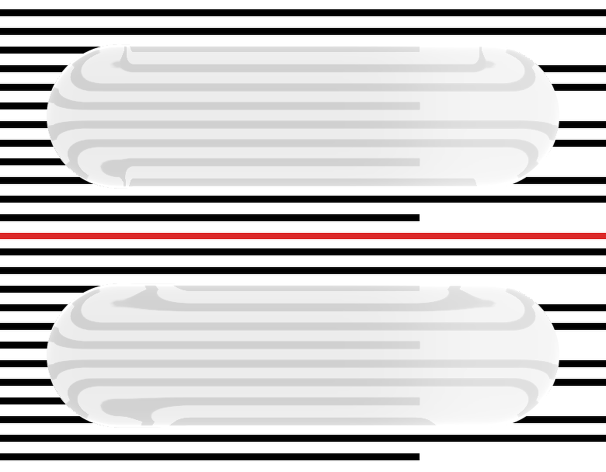

# Lines no longer hook where a capsule's round end begins — 17 November 2026

Source revision: branch `fix/cap-cut` on main `d7733bd2`. Backend: desktop JVM, Skia, a Compose render of `Glass.Regular`
(`glassEffect`, `LiquidGlassTheme`) on a 220 x 62 dp capsule at 3x over black 3 dp lines on white. "Before" is clean
`origin/main` (`d7733bd2`); "after" is the branch. The same render on main before #210 (`0e2f7a63`) shows the same hook,
finer, so it is older than the measured material. Nothing here was captured on a phone, and no iOS frame is shown.

## The cause

At rest the measured profile lenses only at corner arcs: a straight run shows nearly what is under it (`u + 0.06 (1-u)^2`),
a cap shows the measured resting-corner map (`GlassRestMap.Measured`), and `cornerWeight` blends the two along the run.
Near the rim the two maps show rows about 0.7 of the band apart (the outer band of a cap shows content from 0.64-0.88 of
the band inside). The blend ran over 0.2 of the corner radius, about 19 px on a 31 dp cap, so a line under the junction
was dragged through those rows within a few pixels: a short vertical tick at each cap start, top and bottom. Over flat
grey the junction is clean (a source remap cannot draw on a flat backdrop), so nothing else contributes.

## What changed

The blend now runs over one radius along the run. It is authored: the width of this blend was never measured (vertical
stripes cannot show it; see `docs/limitations.md`). The cap keeps the full measured map, and the tab bar's bodies, which
use their own corner weight (`bodyCorner`, `poseCorner`), are untouched.

`GlassCapJunctionTest` renders the map alone over a vertical ramp, so a pixel's level says which row it shows, and
measures how fast the shown row moves along the run near each cap start: main 3.46 rows per pixel, the branch 0.69
(gate: under 1).

*Our renders only. Top: main. Bottom: this branch. Dark and light appearance. The hook at each cap start (a short vertical
tick in the outer band) becomes a gentle sweep that starts about one cap radius before the round end.*

## Limits

- Authored, not measured: whether iOS hands over over one radius, over less, or not at all along the run is not known
  from the captures on hand.
- JVM Skia renders, not a device capture.
