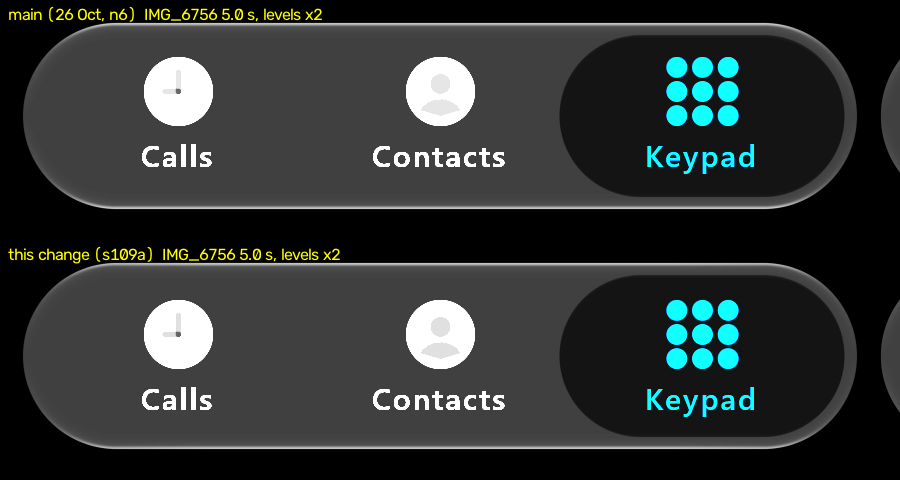

# Resting rim at the caps (#109) — 1 November 2026

Our frames only: desktop JVM GPU replay (`:desktop:phoneReplay`, `calm`). Above is main on 26 October (`n6`, script
`script3.txt`). Below is this change (`s109a`, script `rest9.txt`, the same resting bar). Scene px 40-940 × 430-670,
levels doubled so the rim is visible. The 26 October baseline predates #144's glyph changes, so ignore the glyphs. iOS's
frames are measured, not reproduced.

## Measured

iOS 27's resting bar (IMG_6756 at 5 and 8 s, dark) lights its top and bottom rim at 99-100 along the straight run.
The rim dims from about two cap radii before each end, through the cap. Ours stayed at 98 up to the cap.

Top-rim peak luma (rows 440-470, max over rows, 9 px column mean), mean of 5 and 8 s:

| x (scene px) | 120 | 140 | 160 | 180 | 200 | 240-720 | 760 | 800 | 820 | 840 | rms vs iOS |
| :-- | --: | --: | --: | --: | --: | --: | --: | --: | --: | --: | --: |
| iOS | 67 | 80 | 89 | 87 | 89 | 100 | 87 | 87 | 80 | 67 | |
| main (n6) | 77 | 94 | 98 | 98 | 98 | 98 | 98 | 98 | 92 | 76 | 8.4 |
| this change | 69 | 85 | 90 | 92 | 93 | 97-98 | 93 | 90 | 83 | 68 | 3.1 |

## The change (authored fit)

On a resting bar with `GlassStyle.capFold` (dark Calm), the rim highlight is scaled by
`1 - 0.2 · clamp((2r - s) / 1.6r, 0, 1)`, where `r` is the cap radius (half the bar's height) and `s` is the distance from
the bar's end. It applies to long capsules only (width more than twice the height), so the round search button keeps
its rim, and never to the held lens. It is gated on a specular rim (`uSpecular > 0`), so light Calm, which has none,
keeps its held glow at the caps unchanged.

Not changed: the cap outline itself. iOS's ends ease in over about 20 px more than ours (issue comment, 1 Nov), so a
softer cap shape is the other half of #109. Not yet checked on a device.
