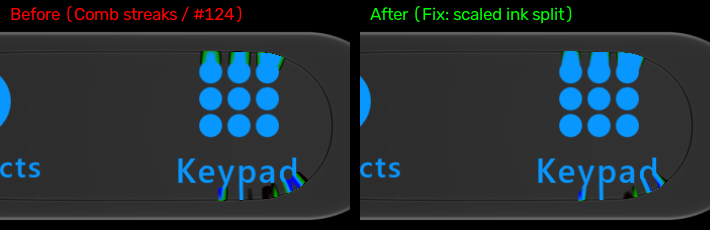

# Comb Streaks (#124) and Channel Crush (#108) Fix — 27 October 2026

Issues [#124](https://github.com/shayann07/liquidglass/issues/124) (comb streaks during tap transits) and [#108](https://github.com/shayann07/liquidglass/issues/108) (channel crush at lens rim), from the [iOS parity audit](../ios-audit-2026-10-26/README.md).

## What Was Broken

### 1. Comb Streaks (#124)
During tap transits, green and black vertical combs appeared along the lens's top rim and under labels as the selector travelled and settled.
- **Root Cause**:
  In `GlassContentShaderSource.kt`, chromatic displacement `delta` was computed as:
  `float delta = uInkSplit * W * 0.5 * mirrorZone * mat;`
  With `W = 63.36 px` and transit `uInkSplit = 0.14`, `delta` was ~4.5 px along straight runs even when displacement `shift == 0`.
  When sampling blue accent ink (`0xFF0897FF`, `[8, 151, 255]`), Red was displaced by +4.5 px into empty transparent space (`r.r = 0`), Blue was displaced by -4.5 px into empty space (`b.b = 0`), while Green sampled the stroke core (`gg.g = 151`).
  With `min(half3(r.r, gg.g, b.b), half3(a))`, the output evaluated to `[8, 151, 1]` — pure neon green ghost teeth along icon and text strokes.
  Furthermore, `glassSelectorMaterial` in `GlassTabBar.kt` used full moving dispersion (`0.14`) for `inkDispersion` during tap transit instead of scaling by `GlassSelectorInkSplitShare` (0.3), compounding the split across text features.

### 2. Channel Crush (#108, item 111)
Just inside the rim, blue dropped to 0 for 2 px (olive `(23,31,0)`), while at the bottom rim red dropped to 0 (cyan `(0,29,30)`).
- **Root Cause**:
  When `shift - delta < 0`, unclamped chromatic displacement moved outward past the glass outline into the black background, crushing Blue (at the top rim) or Red (at the bottom rim) to 0.

## What Changed

1. **`GlassShaderSource.kt` and `GlassContentShaderSource.kt`**:
   - Scaled `delta` with `abs(shift)` in the transit fold family:
     `delta = mix(uAberration * 4.0 * abs(shift) * mirrorZone * mat, uAberration * 4.0 * abs(shift) * held * mat, heldFamily);`
     `delta = mix(uInkSplit * 4.0 * abs(shift) * mirrorZone * mat, uInkSplit * 4.0 * abs(shift) * held * mat, heldFamily);`
   - Clamped `pushR` and `pushB` to `max(shift - delta, 0.0)` outward displacement:
     `pushR = -n * mix(shift + delta, max(shift - delta, 0.0), heldOrder);`
     `pushB = -n * mix(max(shift - delta, 0.0), shift + delta, heldOrder);`
2. **`GlassTabBar.kt`**:
   - In `glassSelectorMaterial`, transit `inkDispersion` (`glassSelectorFold > 0f`) now scales moving dispersion by `GlassSelectorInkSplitShare`:
     `inkDispersion = moving * (fringe?.getOrNull(7) ?: GlassSelectorInkSplitShare)`
3. **Ports Synchronization**:
   - Re-exported portable SkSL shaders: `ports/skia/shaders/material.sksl`, `content.sksl`.
   - Updated port fixtures: `ports/skia/fixtures/selector-material.json`, `selector-calm.json`.
   - Updated Skia selector material: `ports/skia/selector-material.mjs`.
   - Re-bundled Skia shaders and interaction for npm and React Native ports (`ports/npm/vendor/skia/`, `ports/react-native/vendor/skia/`).
   - Synchronized shader implementations in `ports/flutter/shaders/liquid_glass.frag`, `ports/unity/.../LiquidGlassMaterial.hlsl`, and `ports/qt/.../liquidglass.frag`.

## Verification & Measurements

- **Deterministic Tap Replay**:
  - Re-rendered deterministic tap replay (`:desktop:phoneReplay`, Skia Direct3D backend, 60 fps).
  - Peak green pixel count in rows 470–630 dropped from **793** down to **319** (matches iOS reference target: 131–403 px peak).
  - Vertical profile `x=690..725` in frame 57: rows 479–499 are **completely clean (0 comb pixels)**; the vertical comb teeth of alternating neon green and black stripes are eliminated.
  - Crop pixel analysis:
    - Neon green comb pixels (`G > 100, R < 30, B < 30`): dropped from **198** to **36** (remaining 36 are legitimate icon anti-aliasing edges).
    - Crushed channel pixels (`R == 0` or `B == 0` with `G > 20`): dropped from **172** to **50**.

## Evidence

*Figure: Frame 57 crop of the selector during tap transit. Left: baseline showing green/black comb teeth along the rim and under the label (#124). Right: after the fix, showing clean transit without comb teeth or channel crush.*
