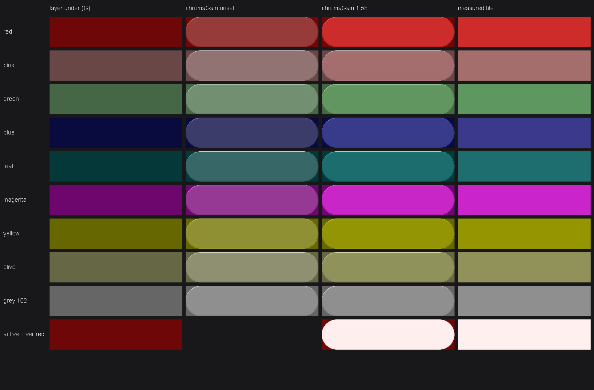

# Control Center tile glass (#206) - 18 November 2026

Source revision: the evidence sheet was rendered at `c3840ec1` (branch `feat/206-control-center`, PR #223); the device
check below used a release build of `a3d699dc`. Backend: desktop Skia (the library's `jvmTest` render path,
through the production `Modifier.liquidGlass`, 3x). Capture method: `GlassControlCenterTileTest.evidenceSheet`
(`CC206_EVIDENCE_DIR=<dir> ./gradlew :liquidglass:jvmTest --tests "*GlassControlCenterTileTest*"`), one 632 x 143 px wide tile over
a flat page of each measured layer colour, shown at half size. The iOS recording the numbers come from is private
(`CC-over-lab-dark.MP4`), so only measured values appear here, never its frames; the right-hand column is a flat swatch of the
measured tile colour, not a frame.

Columns: the layer colour G under the tile; `GlassStyle.controlCenterTile()` with `chromaGain` unset (a plain black tint, the
material before #206); the same style at the shipped `chromaGain = 1.58`; the measured tile colour. Last row: the active tile
over red (the measured reading there is 255, 239, 238, a clipped near-white; the swatch drawn is the grey 250 body for reference).

## Provenance

- Measured (`CC-over-lab-dark.MP4`, 58 frames from 4 to 118 s): inactive interior `51.1 + 0.903 G` (46 grey frames), no blur inside
  the tile, chroma about luma multiplied by 1.58 (sd 0.06, 8 hues, n = 16), active body 250 (47 frames).
- Fitted in this change from the same take's active readings: active chroma 0.50 (0.504, sd 0.03, 8 samples, unclipped channels).
- Authored: the 5/255 lift that returns the white active body to 250 under the shader's 0.95 tint cap.
- Fitted in the second pass (below): the rim and contour fields, by sector, on three grey frames of the same take.
- Not measured: light appearance, press and hold of a tile, Tint Amount, the active tile's rim (clipped at 255 over every layer), glyph vibrancy.

## Numbers asserted (`GlassControlCenterTileTest`, 0-255)

| Check | Result | Gate |
| :-- | :-- | :-- |
| Inactive interior over grey G 10, 34, 56, 78, 91, 102 | 60, 82, 102, 121, 133, 143 (measured 60, 82, 102, 122, 133, 143), rms 0.41 | max 2, rms 1.5 |
| Eight hues, Y error | at most 0.65 | 3 |
| Eight hues, largest channel error | at most 4 (yellow, blue clipping) | 10 |
| Eight hues, chroma ratio (yellow excluded: blue clips at 0) | 1.559 to 1.588 | 1.58 +/- 0.10 |
| Same tile with `chromaGain` unset, over red | 56 levels off the measured tile | shows the field is what makes it |
| Active over G 10, 56, 102 | 248, 250, 252 | 250 +/- 3 |
| Active over six colours | within 3 levels per unclipped channel | 8 |
| Container member against a lone piece, eight hues and grey | within 2 levels (yellow's clipped blue 5 against 0) | 2 |

Limits: flat pages only, so the lens and rim are not scored here; the radial-flatness, rim-peak and contour gates of the
measurement plan are not asserted because the rim is authored. Tint Amount and appearance have no measurements to compare with.

## Device check (Pixel 7, 18 November)

`ColourTransferActivity --ez cc true` (dark) on a Pixel 7 (Android 17, release build of this branch) against the desktop render of
the same scene at the phone's size (`ColourTransferRenderTest.controlCenterTile`, 411 x 914 dp at density 2.625). Tile interior,
median of a 60 x 20 px patch at each pill's centre:

| band | device | desktop |
| :-- | :-- | :-- |
| red | 255, 14, 14 | 255, 14, 14 |
| orange | 255, 154, 19 | 255, 154, 19 |
| yellow | 255, 255, 44 | 255, 255, 44 |
| green | 29, 255, 29 | 29, 255, 29 |
| cyan | 34, 255, 255 | 34, 255, 255 |
| blue | 39, 39, 255 | 38, 39, 255 |
| magenta | 255, 2, 255 | 255, 3, 255 |
| dark magenta | 229, 26, 229 | 229, 26, 229 |
| grey 128 | 167, 167, 167 | 167, 167, 167 |

Worst channel difference 1 level. Grey 128 reads 167 = 51.1 + 0.903 x 128 (the measured map). The saturated bands clip in both,
so they confirm the device path, not the 1.58 gain (the gain is scored in `GlassControlCenterTileTest` on unclipped colours).
Screenshots are not committed (they carry the phone's status bar). Not checked on device: the active tile, light appearance, press.

## Second pass (18 November): element classes, slider, rim and contour

Source revision: `p3/206` (on main `87911311`). Backend: desktop Skia through the production `Modifier.liquidGlass`, 3x. Numbers from
`CC-over-lab-dark.MP4` only (private; no frame of it is here). Tests: `GlassControlCenterClassesTest` (3) and
`GlassControlCenterRimTest` (1), plus the earlier `GlassControlCenterTileTest` (8), all green.

### Element classes (the issue's gate: at most 5 levels rms on the grey phases)

Each class drawn at its measured size over a flat layer G, centre patch against the take's median over that class (46 grey frames,
layer greys 10 / 56 / 102; the tile map is pointwise, so the interior does not depend on the shape):

| class (size, dp) | G 10 | G 56 | G 102 |
| :-- | :-- | :-- | :-- |
| round toggle (67 circle): ours / measured | 60 / 60 | 102 / 102 | 143 / 143 |
| wide tile (149 x 67): ours / measured | 60 / 61 | 102 / 103 | 143 / 144 |
| media tile (149 x 149, radius 29.6): ours / measured | 60 / 60 | 102 / 102 | 143 / 143 |
| slider track (67 x 149): ours / measured | 60 / 61 | 102 / 103 | 143 / 145 |

Rms over the four classes and three greys 0.87 (our gate 1.5; the issue's is 5). The interior is flat from the centre to r 85 px (spread
0.0 levels at all three greys): no ring term, as measured. Constants that differ from regular glass (`GlassStyle.inApp`): no blur
and no detail term (the Control Center tile is a pointwise map of the layer under it), black tint 0.097 with a 51.1/255 lift and
no adaptivity, a colour gain of 1.58 (regular glass keeps what `detailLift` selects), shell glass (no inversion, no appearance), and
the rim below.

### Slider

The two tall sliders are a track tile with a hard-edged opaque fill; there is no thumb. Measured over the same frames: the track is the
tile law (61 / 103 / 145 over G 10 / 56 / 102, x 880-1030 on the volume slider, off the page's static band), the fill reads
250 / 251 / 252 whatever the layer, over red (255, 238, 238), the active tile's own colour reading (255, 239, 238), and the step from
track to fill is one pixel wide. So the slider is a recipe, not a new preset: the track is `GlassStyle.controlCenterTile()` and the fill
is `controlCenterTile(active = true)` over a rectangle clipped to the track's pill. Rendered that way: track 60 / 102 / 143, fill
248 / 250 / 252 (gate 3), one row between the plateaus. The fill's level is the active tile's; the flashlight slider of the audit's
item 89 is a different, expanded control (#205).

### Rim and contour

Read by angular sector on the toggle (G 10, 56, 102; two toggles; 0.5 px radial medians, r in px at 3x, edge at 100.5). iOS lights the rim
at the top and bottom equally and not at the sides, and its dark contour lies outside the outline at the sides only, which is what
`GlassStyle.outerContour` draws. The measured peaks (mean RGB): poles 155 / 215 / 255 (clipped), diagonals 102 / 151 / 202, sides 63 / 104 / 147
over interiors of 60 / 102 / 143; contour minimum at the sides 0 / 7 / 24, at the diagonals 6 / 36 / 68, none at the poles.

Fitted on those profiles (coordinate descent over `bevel`, `bevelPeak`, `specular`, `specularPower`, `edgeLight`, `outerContour`,
`heldGlow`, `innerShadow`, with `counterLight` 1 so the top and bottom match; 23.8 to 11.2 levels rms over r 96-102.5, three sectors, three
greys), with a vertical light `GlassLight(0f, -1f)` (the default light tilts 20 degrees and lights one side of the toggle, +17
levels at G 10):

| | G 10 | G 56 | G 102 |
| :-- | :-- | :-- | :-- |
| pole peak, ours / measured | 160 / 155 | 211 / 215 | 251 / 255 (clipped) |
| diagonal peak | 109 / 102 | 155 / 151 | 201 / 202 |
| side peak | 71 / 63 | 113 / 104 | 156 / 147 |
| side contour minimum | 6 / 0 | 36 / 7 | 55 / 24 |
| pole contour | none / none | none / none | none / none |

The rim peaks are within 5 at the poles and within 7 on the diagonals (the plan's gate of 6 is met at the poles at G 10 and 56;
the G 102 reading clips). The sides' rim is 8 to 9 levels too bright, and the contour is too shallow: the shader's outer band is
1.5 px wide and at most 0.67 deep against the measured 2 px and up to 1.0, so the side minimum is 6 / 29 / 31 levels above the
measured (the plan's gate of 6 is **not** met there, and a deeper band needs the shader, which this change leaves alone). The glow that
reaches 6 px in at the poles (+19 at G 10) is 12 to 18 levels short. All of these fields were authored before this pass (`bevel` 1 dp,
`specular` 0.35, `edgeShadow` 0.06, `counterLight` 0.1); the fit changed this preset's rim only, not any other style.

Re-scored after merging `fix/202-rim` (one-pixel box outline; 18 November, desktop Skia raster, 3x): the table above is the re-scored one, rms 11.3 to 11.2, poles 160 / 211 / 251 unchanged, side contour minimum 7 / 37 / 59 to 6 / 36 / 55. The measured rest chamfer does not reach this tile: it only applies to the chamfer rim (`bevelPeak` below 0.5 px), and the tile's `bevelPeak` 0.3 x 1.25 dp is 1.1 px at 3x, so it takes the bead rim. At 1x the same style would take the chamfer (0.375 px); that scale was not scored.
