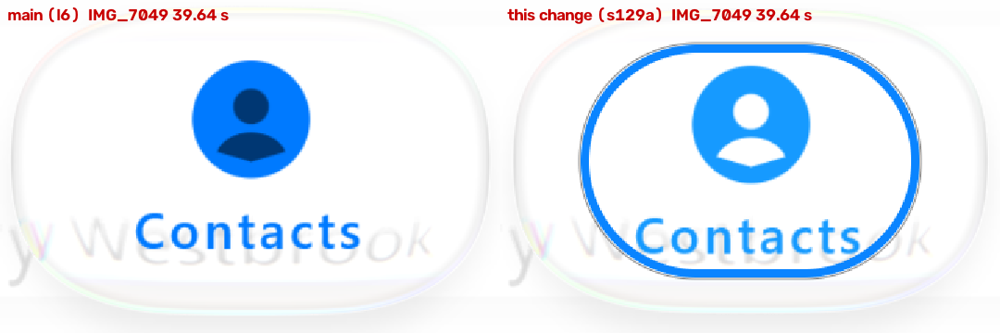

# Glyph cut-outs (#129) — 1 November 2026

Our frames only: desktop JVM GPU replay (`:desktop:phoneReplay`, `calm-light`, script `script-light.txt`). Left is main
before #143 (`l6`); right is this change on current main (`s129a`). Scene px 300-660 × 430-670, enlarged 1.5×. The blue
ring round the right-hand tab is the keyboard focus ring wrongly shown in desktop touch replays since #143, fixed
separately in #157; it is not part of this change. iOS's frames are measured, not reproduced.

## Measured

Mean colour of the person cut-out: iOS's bright pixels inside the selected Contacts disc, and the same pixels in ours.
IMG_7049 at 39.41, 39.64 and 39.87 s.

| | cut-out RGB | bright px in the disc |
| :-- | :-- | --: |
| iOS | (249-250, 254, 255) | 1191-1193 |
| main (`l6`) | (0, 79, 166) | 0 |
| this change | (207-208, 234-235, 255) | 1163 |

The remaining tint is the held lens's own colour behind the hole. The Calls clock hands are cut out the same way.

## The change (sample only)

`PhoneScene` draws the Calls and Contacts glyphs in an offscreen layer and clears their figures with
`BlendMode.Clear`, as iOS's `.fill` symbols are holes. Before, they were painted with a darkened or lightened copy of
the ink. No library change. Not yet checked on a device.
