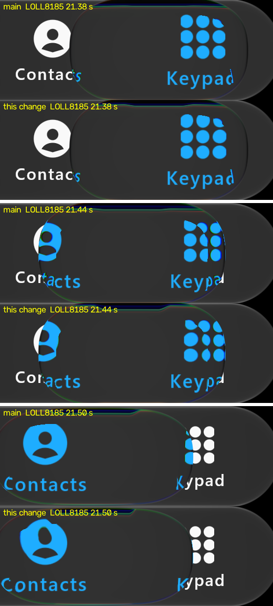

# Held lens sweeping icons round its caps (#121) — 1 November 2026

Our frames only: desktop JVM GPU replay (`:desktop:phoneReplay`, `calm`, LOLL8185's script from 21.0 s, a held drag from Keypad
toward Calls), scene px 380-900 × 450-640. Main is above each pair; this change is below it. iOS's frames are measured, not
reproduced.

## What changed

A held lens that travels mirrors its caps over a band of `GlassSelectorHeldRimMirror` (1.0) instead of the tap's
`GlassSelectorRimMirror` (0.3). iOS's moving held lens sweeps the icons it passes round its caps: the Contacts icon curls
along the left cap and the Keypad dots smear along the right. At 0.3 ours carried the icon almost unbent up to the
outline, which read as a hard vertical cut. Taps keep 0.3, which keeps their labels (26 October). A still held lens is
unchanged: the mirror's weight is its travel.

## Measured, and how it was chosen

The band was chosen by eye on LOLL8185 21.38-21.50 s against iOS, from 0.3 (main), 0.6, 0.6 with gain 0.4, and 1.0 (replay
knob `+fringe`). 1.0 was the only one whose caps swept the icons as iOS's do. A count of blue ink pixels in the cap regions
barely moves (right cap at 21.38 s: 2454 → 2564, iOS 2848), so the sweep's shape is judged by eye, not scored.

The landing label that #151 protects (docs/2 8.625 and 8.65 s, blue label px in rows 570-612): 546 / 511 on main, 825 / 795
with this change, iOS 854 / 1016.

Authored. Not yet checked on a device.
