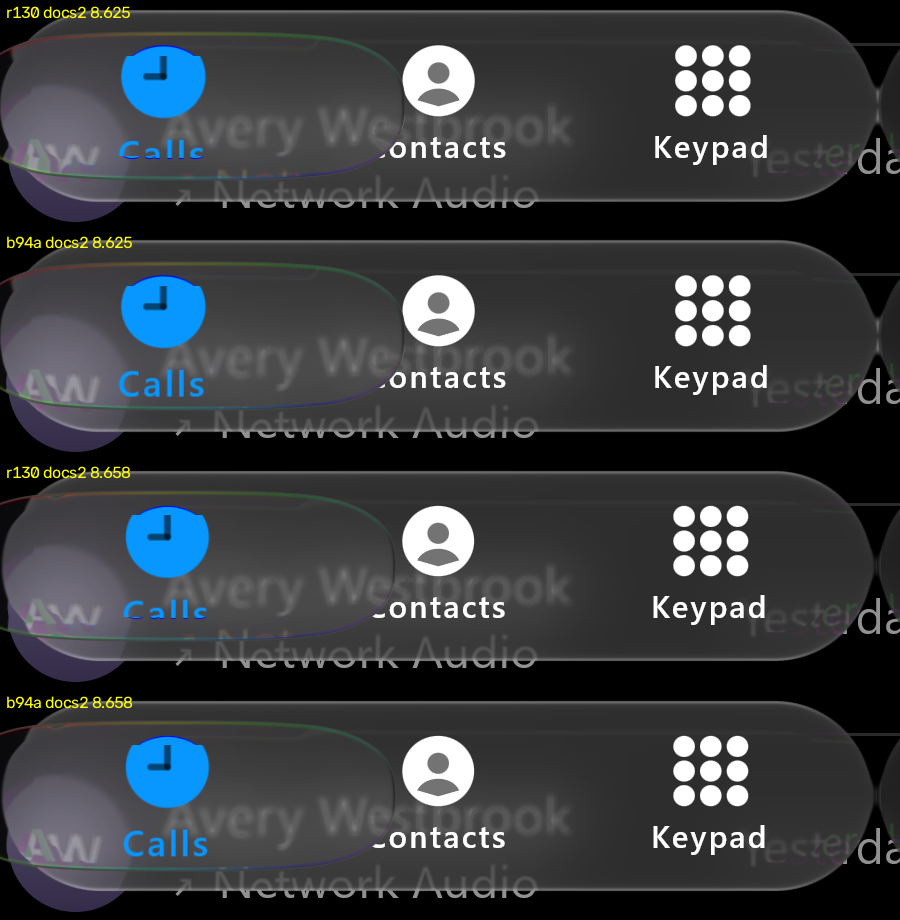

# Held lens: the label survives a throw landing (#94, #111)

Source: branch `fix/94-label-band` (main plus the change). Backend: the desktop GPU replay (`:desktop:phoneReplay`,
variant `calm`). iOS values come from the private recordings, read with the same metrics; no iOS frames are published.

## The defect, and where it came from

On docs/2's throw landing on Calls, our held lens's bottom rim ran through the "Calls" label and cut it. Metric: blue
label pixels in rows 570-612 around Calls (x 100-340).

| frame | iOS | 4ef4a83 | 51e8b6e | main | #130 | #132 | main + band 0.3 | this change |
| :-- | --: | --: | --: | --: | --: | --: | --: | --: |
| 8.625 s | 854 | 735 | 481 | 457 | 481 | 473 | 723 | 724 |
| 8.658 s | 1016 | 702 | 448 | 422 | 459 | 444 | 698 | 698 |

The drop came from 51e8b6e (26 Oct, held-lens refraction): `GlassCalmLensBand` going from 0.3 to 1.1 explains it on its
own. Inside that band the held lens shows a mirrored source, so a label sitting in the wide bottom band was swapped out
rather than bent. These were ruled out on the way: `heldTravelStrain` 0 (456), the squircle outline (473), #130's split
fix (481), and #132's scrub fix (473).

Our frames only: desktop JVM GPU replay (`:desktop:phoneReplay`, `calm`, script `to-9.txt`), main at #130 (`r130`)
above this change (`b94a`), scene px 40-940 × 440-670. The page text is the sample's placeholder content. iOS's frames
are measured, not reproduced.

## The change

The held lens's mirror band keeps its full width (1.1, the #77 fringe fit) at the top and sides, and narrows to 0.3 of
it where its rim faces down (outward normal y from 0.2 to 0.8), in both the content (ink) shader and the material shader.
Authored.

## Fringes (`tools/measure_rim_fringe.py`, threshold 40, ours/iOS per touch, median)

| recording | | integrated | peak |
| :-- | :-- | --: | --: |
| docs/2 to 9 s | #130 | 1.84 | 1.25 |
| | this change | 1.24 | 0.91 |
| IMG_6756 holds | #130 | 0.91 | 2.75 |
| | this change | 0.91 | 1.69 |
| JGEY2190 taps | band factor 1.0 (main) | 0.39 | 0.31 |
| | this change | 0.39 | 0.31 |
| LOLL8185 long drag | band factor 1.0 (main) | 0.66 | 1.08 |
| | this change | 0.50 | 0.74 |

The fringes move toward iOS on docs/2 and IMG_6756 (peak) and are unchanged on taps. LOLL8185's long drag is the
cost: its fringes, already below iOS's, weaken further (integrated 0.66 to 0.50, peak 1.08 to 0.74).

## Factor 0.55, tried and not taken

A milder narrowing keeps more of LOLL8185's fringe but gives back most of the label:

| factor | docs/2 label at 8.625 / 8.658 s (blue px; iOS 854 / 1016) | docs/2 fringe int. / peak | LOLL8185 int. / peak |
| :-- | --: | --: | --: |
| 1.0 (main) | 457 / 422 | 1.84 / 1.25 | 0.66 / 1.08 |
| 0.55 | 532 / 622 | 1.49 / 0.97 | 0.63 / 0.91 |
| 0.3 (this change) | 724 / 698 | 1.24 / 0.91 | 0.50 / 0.74 |

0.3 is kept because the label cut is the defect (#94) and docs/2 is the recording it is measured on.

Not physically qualified on a device.
