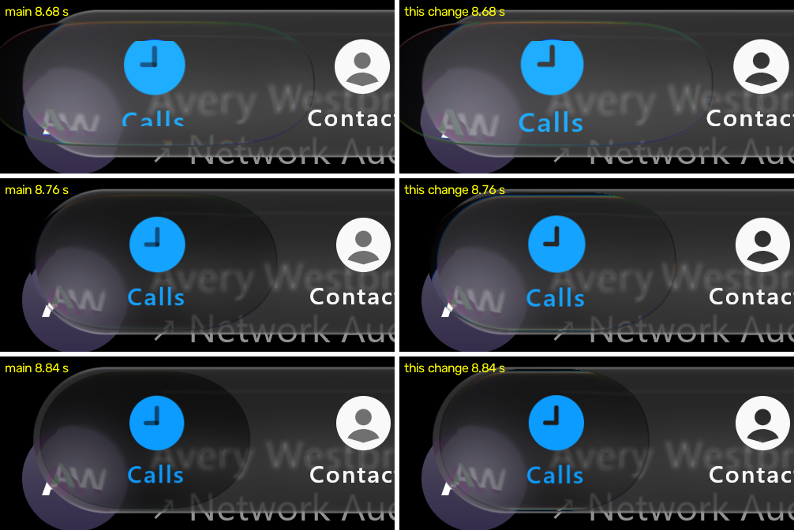

# A thrown lens stays milky as it lands (#111 item 124) — 1 November 2026



Our frames only: desktop JVM GPU replay (`:desktop:phoneReplay`, `calm`, docs/2's script to 9 s). Scene px 20-520 × 440-660.
Main is on the left; this change is on the right. iOS's frames are measured, not reproduced.

## Measured

Luma over x 120-320, rows 485-520 (the landing lens's interior), median, docs/2:

| t (s) | 8.62 | 8.68 | 8.72 | 8.76 | 8.80 | 8.84 | rms |
| :-- | --: | --: | --: | --: | --: | --: | --: |
| iOS | 53 | 60 | 52 | 46 | 31 | 20 | |
| main | 47 | 56 | 45 | 28 | 22 | 19 | 9.1 |
| fade 9 | 47 | 60 | 56 | 46 | 40 | 35 | 7.4 |
| **fade 12 (this change)** | 47 | 59 | 51 | 38 | 32 | 27 | **5.2** |

iOS's thrown lens stays milky about 80 ms longer as it lands. Ours lost its formation at `formOmega` (18/s) once it slowed.

## The change (Calm only)

New internal, opt-in `GlassPoseSpec.releaseMovingFadeOmega`: a lens released while moving loses its formation at this rate once
it slows; 0, the default, keeps `formOmega`. Calm uses 12, chosen from 9, 6 and 12 against the frames above. A still release
keeps its own `releaseStillFadeOmega`. Mirrored in the Skia (`selector.mjs`) and .NET (`CalmSelector.cs`) selectors. No
Compose public API change; the .NET port gains `CalmSelectorSpec.ReleaseMovingFadeOmega` (init-only, default 0, Calm 12), as
its spec mirrors Compose's. Not yet checked on a device; one recording (docs/2).

## Reproducing

The replay (desktop JVM GPU, deterministic) from the repository root, with the private recording's inferred script:

```
./gradlew :desktop:phoneReplay -Patlas.replay.script=<docs2 to-9 script> -Patlas.replay.out=<out dir> -Patlas.replay.variant=calm
```

Then the luma median over x 120-320, rows 485-520, of frames `f00517`-`f00530` (8.62-8.84 s at 60 fps) against the
recording's frames at the same times. The script and the recording stay private (`research/`); this page carries the
numbers and our frames only. Main is `e596de2`'s parent tree for #173's base; this change is `96262af`.
