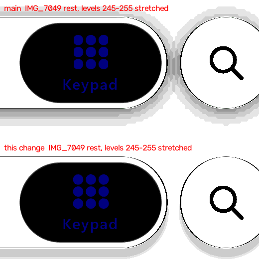

# Light bar shadow (#128 item 1) — 1 November 2026

Our frames only: desktop JVM GPU replay (`:desktop:phoneReplay`, `calm-light`, script `rest3.txt`, the bar resting on
Keypad), at 2.5 s. Main is above; this change is below. Scene px 560-1080 × 420-700. Levels 245-255 are stretched to the
full range so that a shadow 1-4 levels deep shows. iOS's frames are measured, not reproduced.

## Measured

Mean luma against IMG_7049 at rest (48.9, 49.2 and 49.45 s, white page):

| | gap to the search button | beside the bar's left end | 2-21 px under the bar | 22-35 px under |
| :-- | --: | --: | --: | --: |
| iOS | 255.0 | 255.0 | 252.9 | 255.0 |
| main | 251.4 | 253.5 | 252.3 | 254.1 |
| this change | 255.0 | 255.0 | 253.3 | 255.0 |

iOS's shadow is a faint band of the capsule's own shape, straight below it and ending sharply about 7 dp down. Ours was a
soft 11-22 dp blur that spread to the sides, so the bar's and the button's shadows met in the gap as a pale bridge.

## The change (light Calm only)

The light Calm bar's `contactShadow` goes from 0.2 to 0.06, with a 1.5 dp blur and a 6.5 dp offset, in place of the
default 11-22 dp blur and 4 dp offset. These values are read from the frames, not fitted. Dark Calm is unchanged. Not yet
checked on a device.
