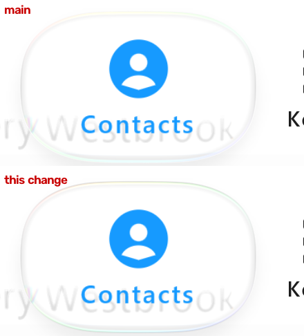

# Light held lens outline (#128 item 4) — 1 November 2026

Our frames only: desktop JVM GPU replay (`:desktop:phoneReplay`, `calm-light`, IMG_7049's script from 36.0 s, the lens held on
Contacts) at 3.64 s (39.64 s in the recording). Scene px 280-720 × 420-660. Main is above; this change is below. iOS's
frames are measured, not reproduced.

## Measured

The darkest luma in the held lens's top rim (rows 425-470, median over x 400-560), IMG_7049:

| t (s) | iOS | main | this change |
| --: | --: | --: | --: |
| 39.41 | 226 | 245 | 228 |
| 39.64 | 226 | 245 | 227 |
| 39.87 | 226 | 245 | 227 |

The bottom rim sits under the label, which dominates that window (129 on both, iOS 119-132), so it is not scored.

## The change (light Calm only)

Light `Calm()`'s held lens draws its outline at `heldEdgeTone` 217/255, was 243/255. The line is 0.9 of that tone over the
glass, so 217 reads 227-228 over the light bar. Fitted to the three frames above; no public API change. Dark Calm is
unchanged. Not yet checked on a device.
