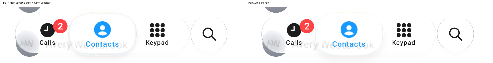

# Light held lens: shadow and lower rim (#104) — 1 November 2026

Our frames only: desktop JVM GPU replay (`:desktop:phoneReplay`, `calm-light`, IMG_7049's script from 36.0 s, the lens held on
Contacts) at 3.64 s (39.64 s in the recording). Scene px 280-720 × 560-700, levels 225-255 stretched so that a few levels show.
Main is above; this change is below. iOS's frames are measured, not reproduced.

## Measured

Luma down the lens's lower half and the shadow below it (x 427-433 and 527-533), mean of 39.41, 39.64 and 39.87 s:

| row | 644 | 648 | 656 | 660 | 664 | 672 | 680 | 684 | rms 640-684 |
| :-- | --: | --: | --: | --: | --: | --: | --: | --: | --: |
| iOS | 255 | 254 | 250 | 247 | 245 | 242 | 246 | 249 | |
| main | 250 | 238 | 238 | 239 | 242 | 248 | 252 | 253 | 7.18 |
| this change | 255 | 255 | 241 | 241 | 243 | 245 | 247 | 248 | 3.43 |

iOS's lens is clear to its lower rim and its shadow darkens gradually below it, deepest about 20 px down. Ours drew two dark
lines at the rim (rows 648 and 656) and a short shadow close under it.

## The change (light Calm only)

Light `Calm()`'s held lens:
- draws no inner thickness line (`innerShadow` 0, was 0.08): it was the line at row 648;
- casts its contact shadow outside the lens only (`contactShadowInside` 0, was 0.5), lighter (0.35, was 0.45), 11 dp down with
  a 9 dp blur (was 5 dp and 6 dp).

Found by elimination: drawing the outline (`heldEdgeTone`) on the top rim only, and removing the edge step (`edgeShadow`),
changed neither line. The values are fitted to the three frames above; no public API change; dark Calm unchanged.

## Not changed

Row 656 still reads 241 against iOS 250: our shadow begins a little darker right under the rim. Checked on a Pixel 7 below.

## On a device

Our frames only: Pixel 7 (Android 17, 90 Hz), release builds of the sample's `PhoneActivity` (`--ez light true`), captured 2 November with `adb exec-out screencap` 1.4 s into a 2.6 s `input swipe` hold on Contacts; crop y 2080-2330. Main is `95c5b6e`, captured twice with identical numbers.

Median luma over x 380-520 down the lens's lower edge (rows 2285-2320, every 5 px):

| row | 2285 | 2290 | 2295 | 2300 | 2305 | 2310 | 2315 | 2320 |
| :-- | --: | --: | --: | --: | --: | --: | --: | --: |
| main | 254 | 238 | 249 | 240 | 243 | 247 | 251 | 253 |
| this change | 254 | 254 | 250 | 241 | 243 | 244 | 246 | 247 |

The line inside the lower rim (238) is gone, and the shadow darkens gradually below the lens and reaches further down, as
the replay showed against iOS (clear to the rim, deepest ~20 px down).
