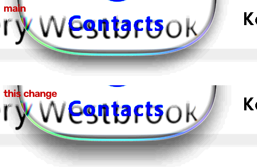

# Light held lens shadow (#104 item 50) — 1 November 2026

Our frames only: desktop JVM GPU replay (`:desktop:phoneReplay`, `calm-light`, IMG_7049's script from 36.0 s, the lens held on
Contacts) at 3.64 s (39.64 s in the recording). Scene px 280-720 × 560-700, levels 225-255 stretched so that a shadow a few
levels deep shows. Main is above; this change is below. iOS's frames are measured, not reproduced.

## Measured

Luma down the lens's lower half and the shadow below it (x 427-433 and 527-533), mean of 39.41, 39.64 and 39.87 s:

| row | 648 | 656 | 664 | 668 | 672 | 676 | 680 | 684 | rms 664-684 |
| :-- | --: | --: | --: | --: | --: | --: | --: | --: | --: |
| iOS | 254 | 250 | 245 | 243 | 242 | 244 | 246 | 249 | |
| main | 238 | 238 | 242 | 245 | 248 | 250 | 252 | 253 | 4.9 |
| this change | 237 | 238 | 240 | 242 | 243 | 245 | 247 | 248 | 2.2 |

## The change (light Calm only)

Light `Calm()`'s held lens casts its contact shadow 8.5 dp down with an 8 dp blur, was 5 dp and 6 dp. Fitted to the three
frames above; no public API change; dark Calm unchanged.

## Also: the inner thickness line

Our lens drew two dark lines along its lower rim (rows 648 and 656: 238 / 238) where iOS's stays clear (254 / 250). The
first is the inner thickness line (`innerShadow` 0.08): with none, row 648 reads 248 and rows 640-684 go from 7.18 to 5.71
levels rms. Light `Calm()`'s lens now draws none; its top rim is the outline's (`heldEdgeTone`). Drawing the outline on the top
rim only changed neither row, so the outline is not the cause.

## Not changed

Row 656 still reads 238 against iOS 250: a second line, most likely the edge step (`edgeShadow`), left for its own fit. Not
yet checked on a device.
