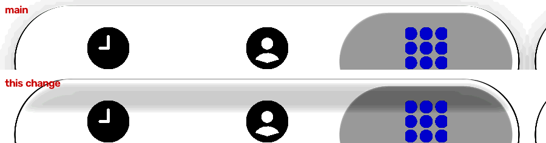

# Light bar top shade (#128) — 1 November 2026

Our frames only: desktop JVM GPU replay (`:desktop:phoneReplay`, `calm-light`, script `rest3.txt`, the bar resting on
Keypad), at 1.5 s. Main is above; this change is below. Scene px 40-940 × 445-560. Levels 230-255 are stretched to the
full range so that a shade 4-5 levels deep shows. iOS's frames are measured, not reproduced.

## Measured

Luma down the bar beside the Keypad pill (x 687-693 and 792-798), IMG_7049 at rest (48.85 and 49.2 s, white page), by
scene row:

| row | 463 | 467 | 475 | 487 | 499 | 507 | 515 | 519-539 | rms (459-535) |
| :-- | --: | --: | --: | --: | --: | --: | --: | --: | --: |
| iOS | 255 | 241 | 240.3 | 240 | 241 | 242.8 | 243 | 245 | |
| main | 255 | 246 | 245 | 245 | 245 | 245 | 245 | 245 | 3.15 |
| this change | 253 | 242 | 240.3 | 240 | 241 | 243 | 245 | 245 | 0.85 |

The search button (x 1007-1033) reads the same as on main, 255 down its top. The shade applies only to shapes wider
than twice their height.

The selected pill sits over the bar, so the shade reaches it too (x 647-653 and 877-883). Rows 471-487 now match iOS
(247.5 against main's 249-253). Rows 491-499 are about 3 levels darker than iOS (239-241 against 241-242; main 244),
so the pill column's rms goes from 2.21 to 2.54. The pill's own gradient (#128 item 3) is a separate item and is not
changed here.

## The change (light Calm only)

New `GlassStyle.topShade` and `topShadeReach`, both off by default (opt-in, AGENTS rule 8). The material darkens by
`topShade` over the top `topShadeReach`: evenly over the first half, easing out by its end, kept off the lit rim (the
bevel), and only on long shapes. It applies before the final clamp, so over a white page part of it is spent above white:
0.02 and 0.025 changed nothing, 0.065 read 7 levels deep. Light `Calm()`'s bar uses 0.056 over 28 dp, fitted to the two
frames above. Dark Calm, the pill and the lens are unchanged. Not yet checked on a device.
