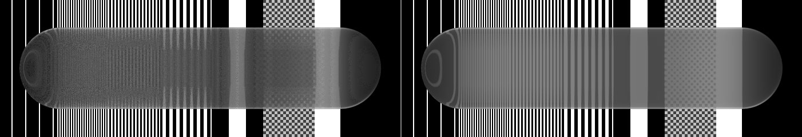
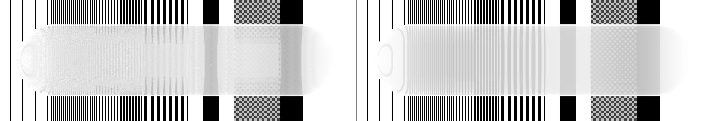
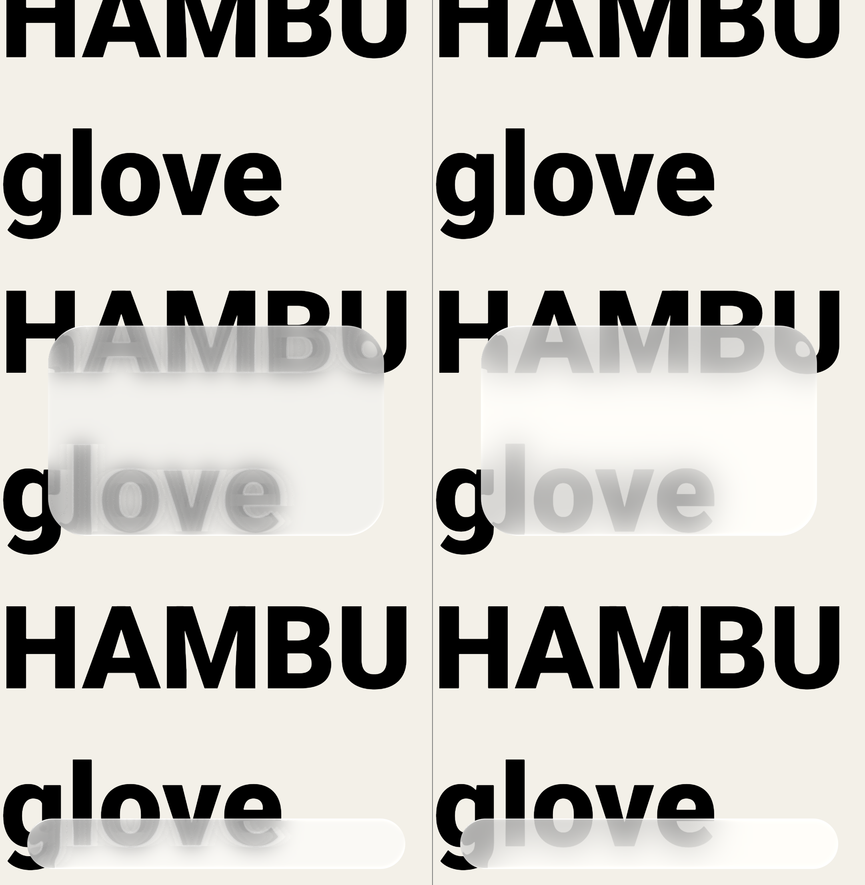
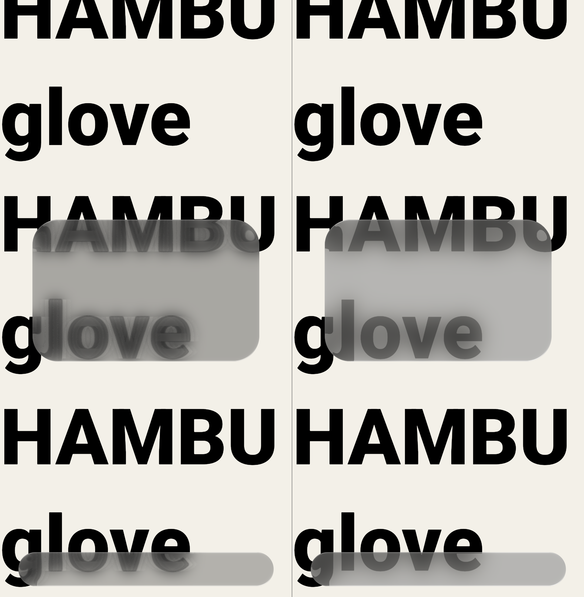

# Lab material model: shader and tint blend (#200) — 16-17 November 2026

Source revisions: main `0e2f7a63` against the #200 branch `feat/200-material-model` at `9730618e`. In every image the
left half is main and the right half is #200. The iOS lab stills the model was measured from are private: only numbers
measured from them appear here, no frames.

## What changed

The glass material now follows a measured model of the lab stills at Tint 50 (`lin = B + k (D - B) + c |D - B|`, then a
tone curve; `tools/glass_model.py` is the public spec). The along-axis high-pass that drew the stepped ghost copies is
removed, the wide kernel gets a 1.5 sigma host pad, and a custom style with a blur reach of 1/3 dp or less gets a
four-tap detail kernel. Between Tints 0 and 100 the lab values are blended in by an authored weight (tracked in #208); Tints 0 and 100 themselves keep
the earlier fit and take only the 1/3 dp detail reach (authored, #208). The
`GlassStyle` API is additive only (`detailLift`, `toneCurve`). "Default look changed" is listed in the CHANGELOG.

## Images

### Synthetic page, `synthetic-<dark|light>-tint<0|50|100>.png`

A test page of stripes (1 to 8 px), bars and a checkerboard under a toolbar-style capsule. Each file is main | #200,
cropped to the capsule and a little page around it, 2 px grey gap between the halves.

- **Source:** the app's own production modifier, rendered by `GlassMaterialEvidenceRender` (jvmTest, opt-in through
  `-Pliquidglass.evidence=<dir>`), main `0e2f7a63` and #200 `9730618e`.
- **Method:** CPU raster, 900 x 480 px at 3x, toolbar style, no recorded data.
- **Limits:** CPU raster is not the GPU path; no recorded content is in the picture; this is a regression view of the
  shader, not a comparison with iOS. Tint 50 is the measured point; 0 and 100 show the authored blend.

### Pixel 7, `pixel7-light.png` and `pixel7-dark.png`

The app's own probe screen (`GhostProbeActivity`: large text, an in-app card and a toolbar capsule at Tint 50), glass
light (`pixel7-light.png`) and dark (`pixel7-dark.png`). Main | #200. Main shows stepped copies of the letters under the
card and capsule; #200 shows one soft copy.

- **Source:** Pixel 7, release build of the sample app at each revision.
- **Method:** `screencap`, one still per build and appearance. The status bar and navigation bar are cropped away
  (rows 125-2335 of 2400 kept); no clock, notification icon or system UI remains.
- **Limits:** one device, one still each; a screenshot is not a timing or motion measurement.

## Numbers

Provenance: **measured** = from the private lab stills or from device runs; **authored** = chosen, not fitted.

Lab gate (private, 89 lab stills, Tint 50, interior zones, rms levels, gate 3.0 per appearance). Measured on
`5ed4d37d` and re-scored on `d939655d` (the tint fade), with the same result.

| | dark | light |
| :-- | --: | --: |
| main | 24.2 | 15.2 |
| #200 | 1.43 | 1.42 |
| #200, vertical stills / horizontal stills | 1.37 / 1.59 | 1.39 / 1.47 |
| the model itself | 1.31 | 1.30 |

Named residuals: 6 px stripes 6.9 dark / 4.5 light; 2 px bars 3.7 dark / 4.5 light. Flat greys are within 1 level.
The stills stay private; only these scores are published.

`GlassLabModelTest` (public): 222 checks pass, including the Tint 0 to 1 and 99 to 100 steps (at most 1.34 rms).
`tintStepsAreContinuous` checks every adjacent pair of whole tints from 0 to 100 over black stems on grey 128 and
0/255 stripes: the worst step is 1.80 levels rms dark (Tint 78 to 79) and 1.65 light (92 to 93). Before the fade of the
detail copy and the legibility term (authored, share 0.10 to 0.02) the switch drew 12.8 dark / 14.4 light at 97 to 98;
main switches at 92 to 93 with an 18-level step. Tints 98 to 100 and Tint 50 render byte-identically with and without the fade.

Pixel 7 timing (measured, 6 rounds each, main `0e2f7a63`):

- 16 Nov night, main against `8155507a`: ghost scroll light 1112 vs 1100 frames in 12 s (p90 26.0 vs 26.7), dark
  1098 vs 1099 (p90 26.2 vs 25.3); calibration animate p90 31.8 vs 30.0.
- 17 Nov, #200 `9730618e`, tab bar: frame p50 13.5-15.5 ms against main 13.8-16.4 ms; GPU p50 9.1-10.1 against
  9.6-10.4 ms; ghost light 1100-1103 frames in 12 s.

docs/1 replay (desktop, Direct3D on the same GPU for both, Calm), #200 against a fresh
render of main 0e2f7a63: 1934 of 1935 frames differ, at most 7 levels, all inside glass. The tab bar's track score is
unchanged (45.4 px rms, median 1.8 px, on both). The search button changes because of the wide-kernel recording pad
(0.75 to 1.5 sigma), not a material split: with the pad factor reset to 0.75 the render is byte-identical to main on 8 pages,
and the search button and the bar measure the same material on both builds. The tab bar keeps its earlier style values until #203.

## Limits

- The lab gate is the model against the lab stills at Tint 50; other tints are authored blends.
- The Tab bar keeps the toolbar's earlier fit until #203.
- Not ported: the npm HTML/CSS engine and `ports/web`. The Flutter Dart port is not compiled (no toolchain here).
