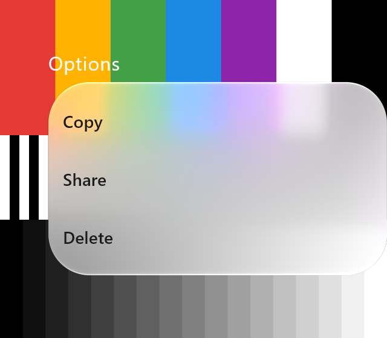
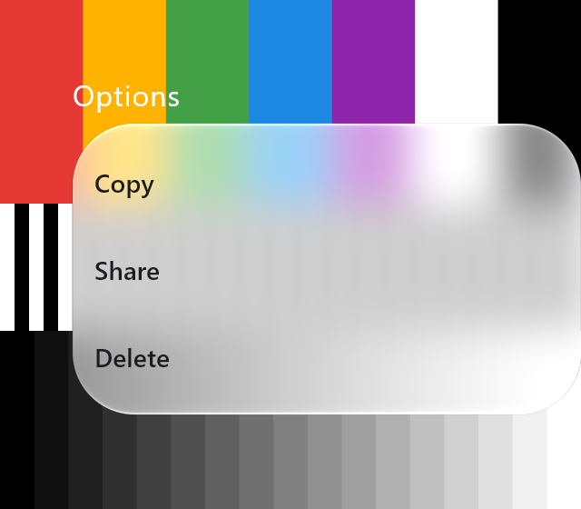
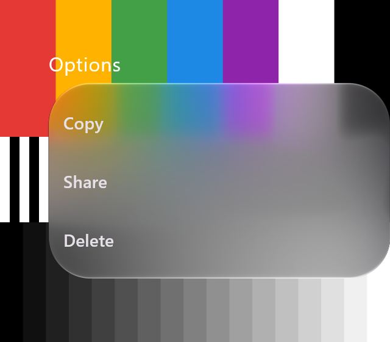
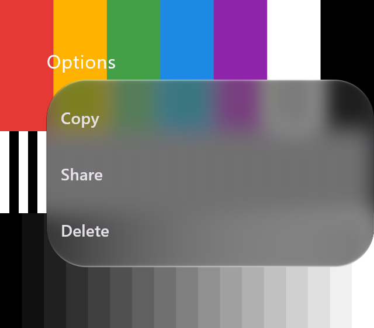

# Glass menu panel (#204)

> Superseded for the dark appearance (18 November, #102): `GlassStyle.menu(dark = true)` is now the measured iOS 27 pop-up menu; see [menu-sheet-2026-11-18](../menu-sheet-2026-11-18/README.md). The dark frames below show the `<select>` fit.

`DropdownMenu` over a chart (colour bars, 16 px black and white stripes, a 17-step grey ramp), before and after.

| | before (`GlassMaterialDefaults.panel`) | after (`GlassMaterialDefaults.menu`, the new default) |
| :-- | :-- | :-- |
| light |  |  |
| dark |  |  |

**Source.** Revision of this commit, both columns in one run: "before" passes `glass = GlassMaterialDefaults.panel`
(what `DropdownMenu` drew before this commit), "after" is the default.

**Method.** `GlassMenuRenderTest` (`liquidglass-material3`, jvmTest): desktop Compose test host, Skia software
backend, 2 px per dp, 160 x 140 dp crop of a 320 x 280 dp window. Desktop renders, not device captures; no Pixel 7
capture was taken for this change (not checked).

**What is measured.** `GlassStyle.menu(dark)` is fitted on iOS 27's Safari `<select>` popup interior only
(`M-select-{dark,light}`): a pure blur, 9.9 dp (dark) and 11.8 dp (light) sigma, then a compressed tone, with no
detail term. Tone over 17 flat greys within 2.3 levels (dark) and 2.0 (light) in `GlassMenuModelTest`; stripes of 16
and 32 px within 1.3 levels rms of a blur-then-tone model. Source fit: 2.08 (dark) and 3.13 (light) levels rms over 12
stripe cases on the video frames, 5.7 on the one 128 px light period.

**Known differences and limits.**
- Held out and not met: the Photos context menu (`COSG3073`, dark) reads 10 to 18 levels lighter than this fit
  predicts over plain patches (32 on the worst of seven). It is a different material or state; it was not fitted.
  The gate was at most 5 levels rms.
- Greys only: how the panel treats colour (the muted bars in the dark frame come from the plain black tint, not from
  a measured colour transfer) was not scored.
- Rim, shadow, corner: not measured for the panel. The rim is the other Material panels' iOS 27 rim, the corner is
  34 dp (measured for iOS 27's menu in #102).
- No scrim: iOS dims the screen to 0.52 behind a context menu; that is the host's job and is not drawn here, so a
  menu over bright content reads a little brighter than on iOS.
- Provenance: constants measured (video, HDR10 decoded, compressed); the Material 3 default change is a decision.
