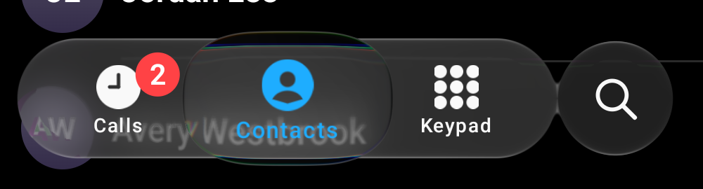
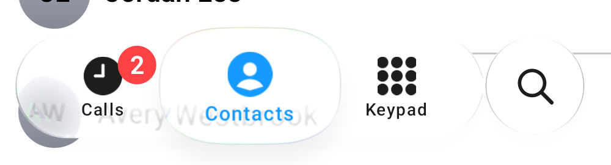

# Pixel 7 checks owed from the 1.1.0 pass — 7 November 2026

Every number here is **Pixel 7, serial 29211FDH200FT8 (Android 17, API 37, 90 Hz), release builds of our sample, desktop
frames only where stated**. This is **not** the unit of the 2 November night (serial 28121FDH2006ZF), so a difference of a
few percent against that night's numbers is not evidence of a change. Builds: old main `13ec13b` and current main `06a33aa`
(the merged #180, #181, #182 and #183; #175 and #176 were already in `13ec13b`). Raw outputs are in `raw/`; the phone
captures themselves stay local (the dark one shows the phone's own status-bar icons), and the two images below are crops
of our bar only. The phone was idle on the launcher or in our app for every run; our sample was uninstalled once, because
the installed copy was signed with another debug key.

## #81: the custom-path field build (PR #180)

Method: a throwaway harness (not committed), identical in both builds, calls the same pooled
`buildPathField(path, w + 48, h + 48, 24, 48)` on the notched closed path the desktop benchmark uses, on a worker thread (a
size-only resize builds on `Dispatchers.Default`); 40 warm-ups, then 61 timed calls, three rounds per build, the two builds
alternating (round 2 in reverse order). It is the build call, not frame time. `raw/field-build-bench.txt`.

| Panel (px) | old main p50 | current main p50 | change | old p90 | current p90 |
| :-- | --: | --: | --: | --: | --: |
| 512 × 256 | 9.63 ms | 8.46 ms | -12% | 9.78 | 8.58 |
| 1080 × 300 | 23.95 ms | 19.85 ms | -17% | 24.40 | 20.15 |
| 1080 × 720 | 56.12 ms | 35.74 ms | -36% | 59.65 | 37.48 |

Medians of the three rounds (1080 × 720 p50 per round: old 52.9 / 56.2 / 56.1, new 35.6 / 35.7 / 37.6). A hash of every texel
of the built field is the same for old and current main at each size (one hash per size over all six runs): the outline is
unchanged. The **first** build after process start is not faster at the smallest panel (512 × 256: 31-36 ms old, 40-51 ms
new, before ART has compiled the new loops), is the same as steady state at 1080 × 300 and faster at 1080 × 720 (36 against
52-56 ms): once per process, on a synchronous first field.

## #93 item 9: the held lens's squircle outline

*Pixel 7, 06a33aa, `screencap` mid-hold (2.6 s `input swipe` held on Contacts), cropped to the bar. Dark above, light below.*

Method: the lens's width at each depth below its crown, scored as in `review/atlas/lens-squircle-2026-10-26` (device px
converted to scene px, ×3 / 2.625; widths in scene px). The crown stands only 9 scene px above the bar on the dark page, so
depths 0 to 8 are measurable (a device row is 1.14 scene px, so depths 0 to 2 are within one row of quantisation).

| depth (scene px) | 2 | 3 | 4 | 5 | 6 | 7 | 8 |
| :-- | --: | --: | --: | --: | --: | --: | --: |
| Pixel 7 | 135 | 155 | 169 | 181 | 190 | 199 | 206 |
| desktop, blend .7 (that folder) | 146 | 161 | 172 | 182 | 190 | 198 | 205 |
| iOS IMG_6756 35.5 s | 148 | 165 | 177 | 188 | 196 | 204 | 210 |
| capsule (before #93) | 167 | 176 | 184 | 190 | 196 | 202 | 206 |

At depths 4 to 8 the phone is within 3 px of the desktop render (rms 4.9 px over depths 2 to 8) and 3-8 px under iOS, the
same side and about the same amount as the desktop. At depth 3 it reads 155 against the capsule's 176, so the blend is
drawn on the device. It rests on one held frame in one appearance (light is not scored: the lens is clear on a white page).

## #104 and the smoke test: the light held lens and its shadow

Light, held on Contacts, the same still. At the lens's top rim the darkest rows read **232** at the centre and 230 at the
shoulder (the 2 November night: 229); the lens is **clear to its lower rim** (row 2290: 255, 2 November: 254); a line at the
lower outline (225 at the centre, 234 at the shoulder); then a shadow that reads **241 right under the rim and rises to
254 over about 45 device px**.

The same rows of the desktop replay of the same lens (`calm-light`, hold on Contacts, `m101` frame 57) read: lower outline
222, then 241 right under it, rising to 253 over about 45 scene px. So **the phone and the desktop replay agree**, to a level.
What they do not do is what iOS does there: in IMG_7049 held on Contacts (37.0 and 37.3 s) the area under the lens stays
at 249-251 just below its rim and **darkens** to 242-244 within 12 to 20 px before it ends. Ours is darkest at the
rim (241 against iOS's 249-251 there, about 8-10 levels) and lighter further down (245 at 20 px against iOS's 242-244). That is a
shape difference in the lens's shadow, not an offset (an 11 dp offset was fitted in #172 against rows 640-684 at 3.43 levels
rms, which this shape difference sits inside). Desktop replay and phone agree, so it is not a device effect.

## #100 and #86: tap timing on current main

Method of the 2 November night (`gfxinfo framestats` per tap, dark Phone page, alternating Keypad and Calls taps), plus the
cold method (a fresh install, first and second tap). `raw/tap-*.txt`.

| | now, 06a33aa (12 taps) | 2 November, main (6 taps) |
| :-- | --: | --: |
| first frame total (p50 / p90) | 37.2 / 49.2 ms | about 33 / 46 ms |
| first frame past its deadline (p50 / p90) | 20.6 / 32.6 ms | about 17 / 30 ms |
| taps with a first-frame deadline miss | 12 of 12 (ten with one miss, two with two) | 6 of 6 (one each) |
| cold first tap, total / past deadline (3 runs, median) | 62.3 / 45.7 ms | 53.0 / 36.4 ms |
| cold second tap, total (3 runs) | 60.6, 68.1, 70.7 ms | 59.6, 64.7 ms |

Three rounds of 8 taps (gfxinfo): janky 1.7-1.9% of 459-464 frames, frame time p50 / p90 / p99 16 / 23-25 / 36-40 ms, GPU p50 / p90
9 / 15-16 ms. The GPU time per tap is bimodal here as it was on 2 November (about 10.5-12 ms in some taps, 19-20 ms in others).
So the **one-first-frame deadline miss per tap is unchanged**, and the first frames read 3-9 ms slower than that night's, within
the spread of n = 3 to 12 on a different unit. No regression is claimed, and none is excluded by this sample. The #86 fuse
follow-up (taps) shows no new miss.

## #66: Flutter and React Native

- **React Native: blocked.** `ports/react-native` is a library with no app project in the repository, so there is nothing to
  build for a frame-timing run; nothing was scaffolded.
- **Flutter:** the example (`ports/flutter/example`, `flutter build apk --release`, the repository's local Flutter SDK, current
  main) scrolls a list under two glass surfaces. `gfxinfo` cannot see it (Flutter draws to a SurfaceView: one frame), and Flutter
  sends no per-app frame-timeline tokens, so only display-level data exists. Ten 350 ms swipes, a Perfetto FrameTimeline trace:
  521 display presents in 7 bursts, gaps between presents p50 / p90 / p99 **11.1 / 11.2 / 11.3 ms** (a steady 90 Hz), one skipped
  vsync, 520 of 524 display frames with no jank (the other four "Non Animating"). `raw/present-cadence.txt`.
- **Compose sample, same trace type, ten taps** (its frames carry tokens): app frames 504-520 per trace, duration p50 / p90 / p99
  16.1-16.7 / 24.6 / 30.5-35.0 ms, 93.3-96.3% finished on time; 85-87% of its frames are flagged "Buffer Stuffing" (the app renders
  ahead of the display, GPU-bound), 8-10 dropped display frames in about 1,000. Its display-gap row in `raw/present-cadence.txt`
  (nominal 6.3 ms) is an artefact of buffer stuffing and is not comparable.
- **These do not compare like for like:** the Flutter scene is a scrolling gradient list under two glass surfaces, the Compose
  scene is the tab bar's tap animation with the selector's refraction. The honest reading is that the Flutter example holds
  90 Hz while scrolling and the Compose Calm bar is GPU-heavier while it animates (the 2 November record: GPU 10-19 ms per frame).

## #78: the web demo's first visit in phone Chrome

Chrome 156.0.8078.79, the live demo at `/demo/#material3` (the build with the 6 s notice from #181), new incognito tabs, the page's
own loader read over DevTools for the demo's target only (nothing else was printed or saved; the DevTools forward was removed).
Page-clock times are milliseconds since navigation start.

| Visit | loader shown | app started | ready | 6 s notice |
| :-- | --: | --: | --: | :-- |
| 1, first (shader cache cold) | not seen (probe attached late) | not seen | at or before **19.05 s** | shown ("Still compiling the glass shaders ...") |
| 2, new incognito tab, probe started first | 0.44 s | about 2.85 s | **4.5 s** | not shown (under 6 s) |

The demo reached ready in both visits; the never-renders case did not reproduce. The glass itself was not seen: Chrome blocks screenshots
and recordings of incognito pages, so "ready" is the loader's state after settled frames. Visit 2 was warm (Chrome's shader cache outlives
the incognito tab), so this is one cold bound and one warm number, not a distribution. Desktop for comparison: 11-17 s cold, 1.2 s repeat.
Firefox is not installed on the phone. No Chrome capture is kept.

## Not done

- **Firefox:** not installed on the phone.
- **#182, the light hold and drag script:** the tool scores against a script of finger positions, and `input swipe` cannot
  replay IMG_7049's path, so the desktop numbers (hold top +6.5, shadow -6.2; drag top +5.0, shadow -6.3) were not reproduced as
  such. What was done instead is the rim-aligned comparison above (hold only).
- **#100 item 86 (text sharpness under the bar, 6.9% against 5.1%):** not repeated; the confound is that the text sits at a
  different offset under the bar in the replay scene and on the phone, which more frames do not remove.
- **#65:** needs other devices.
