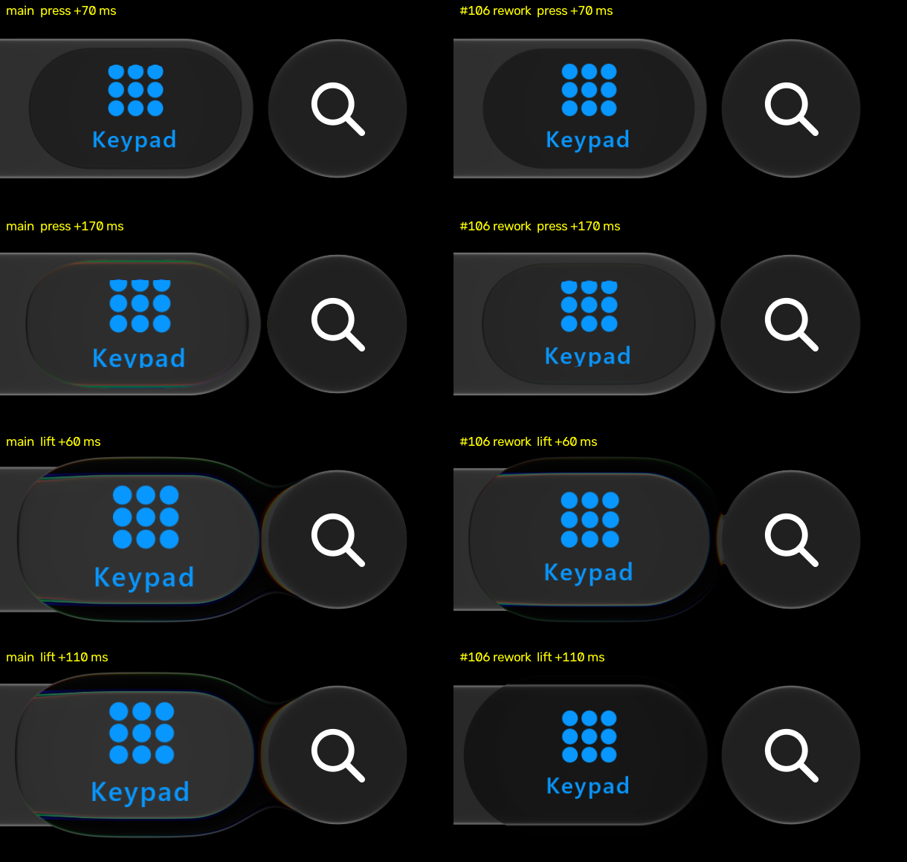

# Still press and still release timing (#106, audit items 104, 105, 107)

Source: `GlassPoseSpec.Calm` at the #106 rework (branch `fix/106-press-release-timing`, on top of #131).
Backend: the desktop GPU replay (`:desktop:phoneReplay`, variant `calm`), driven by the IMG_6756 script
cut to its three still holds on Keypad (34.628-36.140 s, 36.980-38.624 s, 39.380-40.725 s). iOS values
come from the private recording, read by the same metric; its frames are not published.

Metrics, scene px:
- **Lens level:** the median display level of rows 460-472 over x 682-802, inside the bar above the icons.
  The resting pill reads about 11-15 and a formed lens 50-55.
- **Lens top:** the first row brighter than 22 in columns 730-750.

## Release (item 104)

Lens top after the first lift. The other two holds agree within a frame.

| after lift | iOS | main | #106 rework |
| :-- | :-- | :-- | :-- |
| 43 ms | 439 | 434 | 434 |
| 60 ms | 443 | 434 | 435 |
| 77 ms | 447 | 434 | 452 |
| 93 ms | 451 | 434 | 450 |
| 330 ms | 453 | 437 | 453 |

iOS's outline collapses from about 43 to 93 ms after the lift. Main's holds for about 330 ms
(`releaseStillHoldSeconds` .18, authored from docs/2). The rework holds 35 ms, then fades at
`releaseStillFadeOmega` 100 (authored). Its outline goes at 60-77 ms.

The rework's lens level falls faster than iOS's after that: 23 against 35 at 110 ms. iOS's level also
returns to about 38 between 210 and 310 ms after the lift; ours does not. Both remain open.

| | omega 160 (#133 as opened) | omega 100 (chosen) |
| :-- | :-- | :-- |
| outline gone | 43-60 ms (one frame early) | 60-77 ms |
| level at 60 ms (iOS 47.7) | 37.0 | 41.1 |

## Bar dip (item 105)

Main's dip is local, not a bar-wide spring overshoot:
- At x 300 and 590, the bar top returns monotonically to 453 on main as on iOS.
- Only the lens column (x 730-750) drops to 459 once the late lens collapses, about 340 ms after the lift.
- With the earlier collapse the dip is gone: the column reads 449-453.

So the dark Calm `releaseDamping` (.6, iOS's ~10% bar overshoot) is unchanged; #133 as opened set it to 1.

## Press (item 107)

`pressFormation` 0, `holdThresholdSeconds` .110, `heldFormRiseOmega` 26 (authored):

| after touch-down | iOS | main | #106 rework |
| :-- | :-- | :-- | :-- |
| 53 ms | 11 | 29.9 | 31.0 |
| 120 ms | 18 | 36.0 | 34.0 |
| 170 ms | 42 | 51.7 | 41.0 |
| 203 ms | 50 | 53.1 | 47.0 |
| 237 ms | 54 | 52.4 | 51.2 |

From 170 ms on the rework's level follows iOS's (main's is formed about 50 ms early).

Open: before the hold, our level still jumps to about 31 at 53 ms, and the bar top moves at 53 ms where
iOS's moves at about 120 ms. That jump is the bar's own press response (`GlassInteraction`), not the lens
formation this change sets.

Our frames only (main n6 left, rework right), crop x 560-1170, rows 400-690.

## Checks

- `GlassPhoneLandingSequenceTest`:
  - `aStillReleaseLosesItsGlassAsQuicklyAsIos27`: whole at 25 ms, below .3 at 65 ms, below .02 at 110 ms.
  - `aStillPressFormsOnlyOnceItIsAHold`: no formation before the hold, .4-.65 at 182 ms, above .93 at 300 ms.
- `GlassAccessoryFusionTest.theNeckPartsPromptlyAfterLift`: the zero-stiffness control now reads 17 (joined,
  above 12) where it read above 20.
- Ports: Skia `npm test` 46/46 and .NET Checks pass with regenerated fixtures. The formation tolerance is
  5e-4, because the fast fade amplifies float32/float64 drift.

Not physically qualified on a device.
