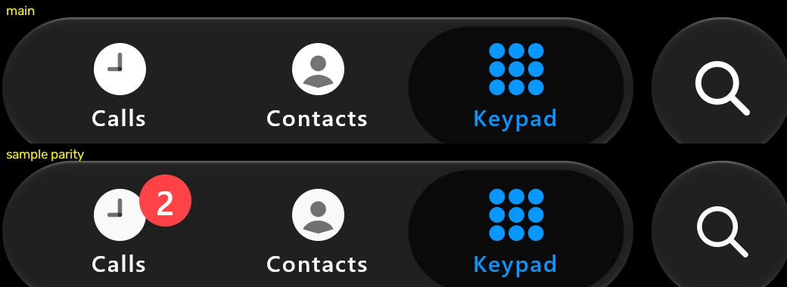

# Sample parity: badge, glyphs and layout (#99, #110)

Source: the sample's `PhoneScene` on branch `fix/99-sample-badge`. Backend: the desktop GPU replay (`:desktop:phoneReplay`,
variant `calm+badge`), IMG_6756 at 34.2-34.4 s, resting on Keypad. iOS values come from the private recording, read with
the same metric; no iOS frames are published. These are sample changes only; the library is untouched.

| | iOS | main | sample parity |
| :-- | :-- | :-- | :-- |
| Calls badge (red bbox, scene px) | x 244-312, y 472-540, (255,66,69) | none | x 244-312, y 471-539, (255,66,69) |
| icon top row (Calls) | 491 | 487 | 490 |
| unselected glyph mean (Contacts, luma > 120) | 240.4 | 244.7 | 239.7 |
| search glyph (luma > 200) | 68 x 68, 1093 px | 72 x 72, 1376 px | 68 x 68, 1086 px |

What changed (all in `PhoneScene.kt`):
- **Badge (#99 item 72):** `callsBadge` draws a 23 dp disc at iOS's colour, placed from the clock's top-left. The
  Android sample shows "2". The replay shows it only with `+badge`, because docs/2 has no badge.
- **Layout (#110 item 118):** tab content sits 1 dp lower.
- **Unselected ink (#110 item 120):** dark ink is (249,249,249), not pure white.
- **Search glyph (#110 item 119):** 24.5 dp (was 26) with about 11 % thinner strokes.
- **Light palette (#110 items 121, 122):** unselected ink (29,29,29) and accent (0,132,250), from IMG_7048 38.5 s as
  recorded in the audit. These were not re-measured here: no light render was compared.

Not changed: the Keypad dots' luma spread (item 117) and the search glyph's blue ring (#99 item 102).

Our frames only, from the desktop GPU replay (`:desktop:phoneReplay`, variant `calm+badge`, IMG_6756 holds script) at
34.2 s, crop x 60-1100, rows 430-620.
