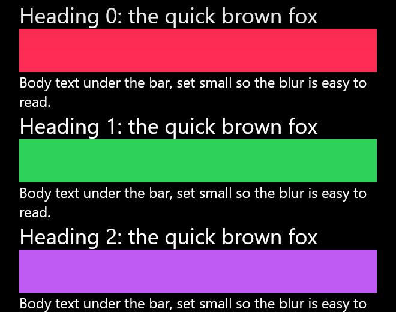
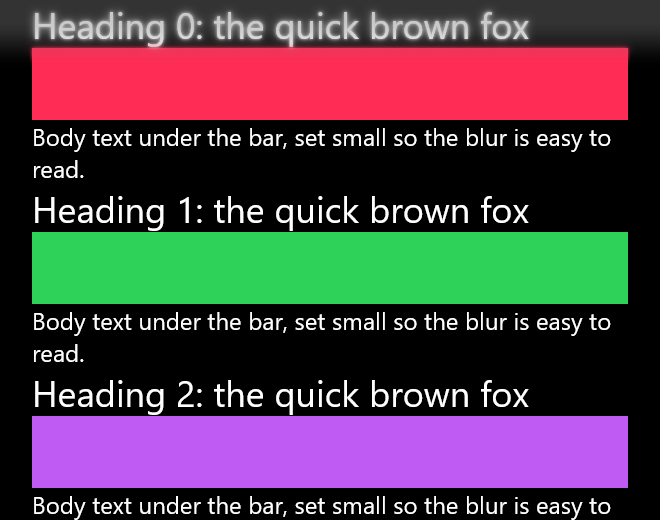
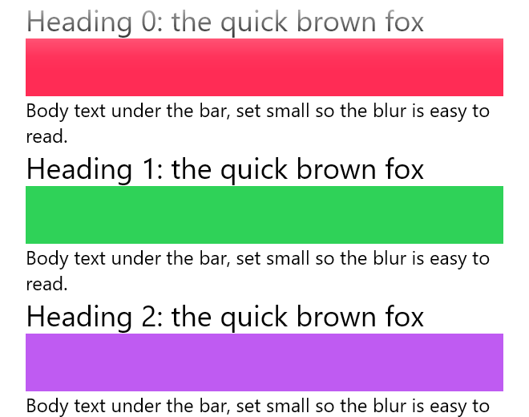
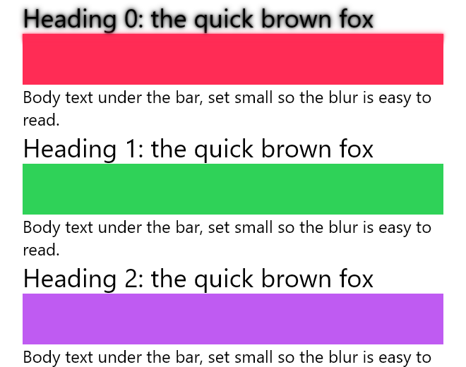

# Scroll edge effect (#207)

A page of colour tiles and text with its first heading scrolled up under the top edge, before and after.

| | before (`GlassScrollEdge`, the composable) | after (`Modifier.glassScrollEdge`) |
| :-- | :-- | :-- |
| dark |  |  |
| light |  |  |

**Source.** Revision of this commit, both columns in one run. "Before" is the composable as it stood (an authored
gradient to the ground colour, peak 0.90, or 0.18 when `inverted`); "after" is the new modifier at full intensity.

**Method.** `GlassScrollEdgeRenderTest` (`liquidglass`, jvmTest): desktop Compose test host, Skia software backend,
2 px per dp, 330 x 260 dp window. Desktop renders, not device captures; no Pixel 7 capture or frame-time pass was done
for this change (not checked).

**What is measured** (`Scr-safari-scroll-{dark,light}`, iOS 27 Safari top edge, 3 px per point):
- Dark tint: grey 124 at `0.41 (1 - smoothstep(10 dp, 34 dp, d))`, 1.3 levels rms against the measured median
  profile in `GlassScrollEdgeTest` (the gate was 5). Light: no tint (blur only).
- Blur, needed in both appearances: edge widths 3.95, 3.14, 2.21, 1.15 and 0.35 px at 65, 75, 85, 95 and 105 px
  from the edge against the measured 4.4, 3.9, 3.0, 1.5 and 0.4 (gate: within 1 px; the render is a little narrower
  than the take at 75 and 85 px).
- The dark "before" frame shows almost nothing: the old composable's inverted dim is 0.18 of the ground, here black on
  black. That is the old behaviour, shown as it was.

**Not measured, authored.** The 24 dp scroll fade-in, the bottom edge (a mirror of the top), the blur's strength
above 20 dp from the edge (the measurement saturates there: lower bounds only), the kernel's shape, and the order
against glass. The blur is two blurred copies of the content, 3.3 dp and 1 dp, laid over it with fitted masks, not a
per-pixel variable blur.
