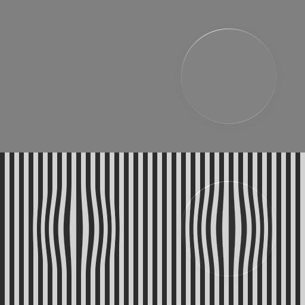

# Skia port: the clear-lens preset, now the default (#191), 18 November 2026

Left column `lighting: false` (the bare magnifier, the lens before 1.1.0), right column `lighting: true`, which is now the default (the Compose clear-lens preset: rim
highlight, thin white tint, contact shadow). Top row a flat grey 128 page, bottom row 8 px black-and-white stripes (45 / 210).
A 160 px lens at magnification 1.4, density 1.

- **Source revision:** `feat/191-193-skia` at d46ddb41 (PR #221), plus the commit that adds this record.
- **Backend:** CanvasKit 0.42 software (`canvaskit-wasm`) on Node, the production SkSL; no GPU, no device.
- **Method:** `node ports/skia/lens-evidence.mjs review/atlas/skia-lens-and-bake-2026-11-18` draws the four tiles with
  `painter.drawLens`; the sheet was looked at. Observed on this render: over grey 128 the rim reads +64 levels at the top and +22
  at the bottom, over black +42 / +15, over pure white 0. `ports/skia/lens.test.mjs` asserts only lower bounds (top at least +40
  and bottom at least +10 over grey 128, +25 / +5 over black) and an interior within 4 levels of the page; pure white is not
  asserted. A Compose render of `GlassStyle.clearLens` measured the same way reads +62 / +20 and +42 / +15.
- **What this is:** an authored preset (Compose's `GlassStyle.clearLens`, "not an Apple calibration"), a regression render of
  the port's own output. It is not a measurement and makes no iOS parity claim.
- **Limits:** one lens size and one magnification; the contact shadow is faint (2 % black) and hardly visible at this scale; over
  pure white the preset is invisible, as in Compose. Not checked on a device or in a browser.

The bake and stateless drawing of #193 change no pixel by design, so they have no render; their evidence is the byte-identical
frame comparison in `ports/skia/bake.test.mjs`.
