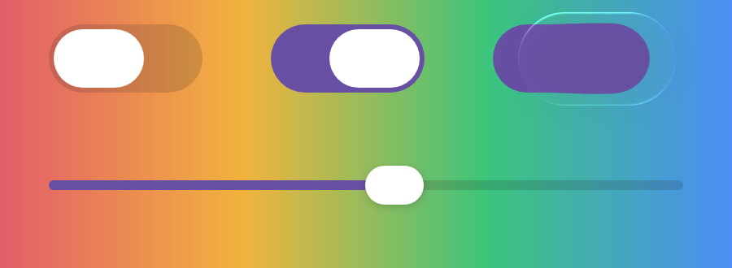
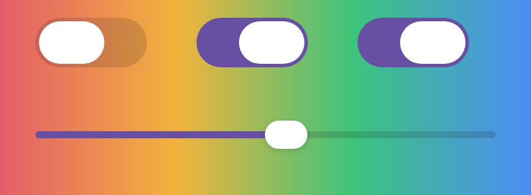
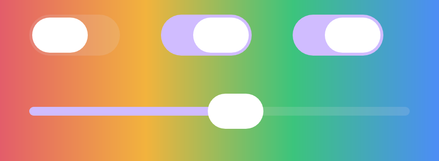

# Glass Switch and Slider, measured geometry (#205)

Before and after renders of `Switch` and `Slider` from `liquidglass-material3`.

| | before | after |
| :-- | :-- | :-- |
| light, rest |  |  |
| light, switch held (right-hand switch) |  |  |
| light, slider held |  |  |
| dark, rest |  |  |

Each frame: off switch, on switch, a held on switch, and a slider at 0.55, over a four-colour gradient.

**Source.** "before" is the library at the parent revision of this commit (`9061f911`, authored 38 x 24 dp
thumb, 1.4x opaque-to-lens press, 6 dp track). "after" is this commit.

**Method.** `GlassKnobRenderTest` (`liquidglass-material3`, jvmTest) renders the frames with the desktop
Compose test host at 3 px per dp, Skia software backend, manual test clock: 600 ms of rest, then a pointer
down on the held control and 600 ms of settling. The label comes from the `ATLAS_LABEL` environment variable.

**Limits.** Desktop software renders, not device captures; no Pixel 7 capture has been taken for this change
(not checked). The lens interior is the library's `Glass.Lens(1.25)`, an authored strength: only the held
outline (64.5 x 38.5 dp) is measured. Colours are Material's theme colours (primary and a 16 percent
on-surface), not iOS system green and grey: the measured colours (47, 210, 88) and (90, 90, 94) are not
applied by default. The "before" held lens sits above the knob because the old thumb scaled about its own
box, as it always did; it is shown as it was.

**Provenance** (numbers are asserted in `GlassKnobTest`):

| quantity | value | label |
| :-- | :-- | :-- |
| switch track | 63 x 28 dp | measured, native UIKit switch, `I-menus-dark` |
| knob at rest | 37 x 24 dp, inset 2 dp, travel 22 dp | measured, same take |
| held knob outline | 64.5 x 38.5 dp (1.75 x 1.6 of rest), clear lens | measured outline, +-1 dp; lens strength authored |
| press-in, release, travel springs | peak about 100 ms, settle 133 ms, 90 percent in 7 frames | measured timing; spring parameters fitted |
| track colour fade | 420 ms | measured on Safari's web switch (timing class only) |
| slider track | 4 dp | measured on Safari's web slider, rendered about 1.12x native |
| slider thumb | 24 x 16 dp opaque white, no lens, no press scale | measured on Safari's web slider; native size not recorded |
| slider thumb shadow, disabled looks, second range thumb, `thumbContent` | - | authored |

Measurement record: `.local/sxs/plans/205-measured.md` (private working notes).
