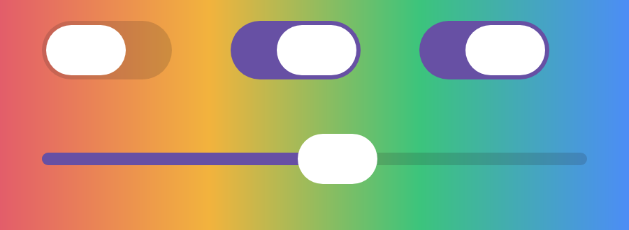
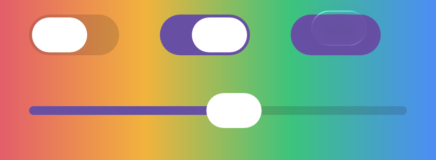
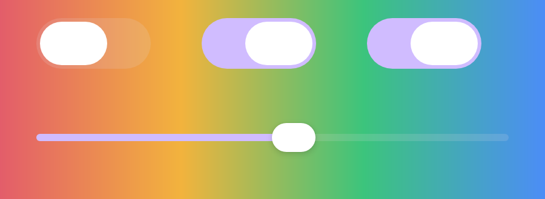

# Glass Switch and Slider, measured geometry (#205)

Before and after renders of `Switch` and `Slider` from `liquidglass-material3`.

| | before | after |
| :-- | :-- | :-- |
| light, rest |  |  |
| light, switch held (right-hand switch) |  |  |
| light, slider held |  |  |
| dark, rest |  |  |

Each frame: off switch, on switch, a held on switch, and a slider at 0.55, over a four-colour gradient.

**Source.** "before" is the library at the parent revision of this commit (`9061f911`, authored 38 x 24 dp
thumb, 1.4x opaque-to-lens press, 6 dp track). "after" is this commit.

**Method.** `GlassKnobRenderTest` (`liquidglass-material3`, jvmTest) renders the frames with the desktop
Compose test host at 3 px per dp, Skia software backend, manual test clock: 600 ms of rest, then a pointer
down on the held control and 600 ms of settling. The label comes from the `ATLAS_LABEL` environment variable.

**Limits.** The frames here are desktop software renders, not device captures (see "Device check" below for the one
Pixel 7 reading)
(not checked). The lens interior is the library's `Glass.Lens(1.25)`, an authored strength: only the held
outline (64.5 x 38.5 dp) is measured. Colours are Material's theme colours (primary and a 16 percent
on-surface), not iOS system green and grey: the measured colours (47, 210, 88) and (90, 90, 94) are not
applied by default. The "before" held lens sits above the knob because the old thumb scaled about its own
box, as it always did; it is shown as it was.

**Provenance** (numbers are asserted in `GlassKnobTest`):

| quantity | value | label |
| :-- | :-- | :-- |
| switch track | 63 x 28 dp | measured, native UIKit switch, `I-menus-dark` |
| knob at rest | 37 x 24 dp, inset 2 dp, travel 22 dp | measured, same take |
| held knob outline | 57.8 x 38.3 dp (1.56 x 1.6 of rest), clear lens | measured on the settled hold (173.35 +- 0.27 px by 115.00 px, cap-arc fits, I-menus-dark); lens strength authored. Earlier 64.5 x 38.5 was read at the tap peak |
| press-in, release, travel springs | peak about 100 ms, settle 133 ms, 90 percent in 7 frames | measured timing; spring parameters fitted |
| track colour fade | 420 ms | measured on Safari's web switch (timing class only) |
| slider track | 4 dp | measured on Safari's web slider, rendered about 1.12x native |
| slider thumb | 24 x 16 dp opaque white, no lens, no press scale | measured on Safari's web slider; native size not recorded |
| slider thumb shadow, disabled looks, second range thumb, `thumbContent` | - | authored |

Measurement record: `.local/sxs/plans/205-measured.md` (private working notes).

## Refit of press and release (19 November, p3/205)

Re-read from the same `I-menus-dark` take (numbers only, no frames): the lens outline is visible only where it is taller than the 84 px
track, so the first fit (release 133 ms to the 24 dp knob) ended the visible part in 58 ms. Measured on a 0.9 s hold (30.41-31.35 s,
60 fps): outline height 85 -> 121 -> 115 px (press, peak at +100 ms, settle), then 115 -> 84 px in 8 frames (133 ms) on release. Spring
fits, rms over the visible frames: press stiffness 625, damping 0.55 (1.0 px; was 1050 / 0.5 at 2.2 px), release stiffness 361,
critically damped (0.9 px; was 1900 at 4.6 px). A tap shows the lens above the track for 18-19 frames (300-317 ms) in all five taps
of the take. Slow drag: while the lens moves 20 px in 0.7 s its size stays 178 x 115 px, so no stretch is measured at that speed; a
fast drag is not recorded (Safari's web take has no lens). Width, resolved: a later cap-arc circle-fit pass (settled holds 30.63-31.21 s and 32.83-33.43 s, 73 frames, validated on the resting
knob to 0.07 px) gives 173.35 +- 0.27 px = 57.8 dp = 1.56x the knob, so the held width is now 1.56x (was 1.75x, read at the tap
peak). The press overshoot reaches 1.63x, as measured (1.62-1.64x).

## Device check (Pixel 7, 18 November)

A release build of `1233f7bd` on a Pixel 7 (Android 17, density 2.625), `MaterialShowcaseActivity`, one screenshot of the mini
player, sizes read off it by eye to about 2 px: slider thumb about 62 x 42 px (24 x 16 dp is 63 x 42), slider track about 10 px
(4 dp is 10.5), switch track about 165 x 75 px (63 x 28 dp is 165 x 74). [`pixel7-mini-player.png`](pixel7-mini-player.png) is that
screenshot cropped to the mini player (rows 1840-2090, columns 40-1040 of 1080 x 2400; the status bar is not in it), unscaled, at the
phone's own pixels. Not checked on the device: the held knob, press timing, the light switch.
