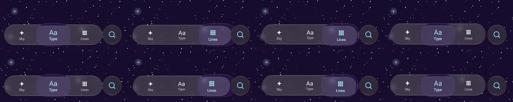

# Held tab bar: no sideways stretch (`GlassPullShape.AreaPreserving`, #203 PR B)

| Item | Value |
| :-- | :-- |
| Source, old (top row) | `feat/203b-calmclear` at a80166a8: the bar takes the whole pull |
| Source, new (bottom row) | the same plus the stretch fix (2482a687): a long bar takes only the vertical part of a pull |
| Device | Pixel 7, Android 17, release build of the sample |
| Screen | `LoupeActivity`'s Calm bar over its star field |
| Capture | Hold the Type tab, then drag 315 px up, right, or diagonally (223, -223) with `adb shell input`. Screenshot mid-hold. |
| Crop | Rows 1900-2330 of the 1080 x 2400 screenshot, halved: app pixels only, no status or navigation bar |

Bar height (**measured**: the longest run brighter than 45 at columns x 330 and x 560; both columns agree within 1 px):

| Drag | Old law | New law |
| :-- | --: | --: |
| hold, no drag | 171 | 171 |
| right 315 px | 167 (squashed) | 169 |
| diagonal 223, -223 | 169 | 172 |
| up 315 px | 177 | 177 |

The new law leaves a long bar's shape alone under a sideways drag. iOS 27's held Phone bar does the same: its left edge stays at 42-43 px through a right drag in the owner's 18 November takes. The upward pull (the T04 law) is unchanged.

Limits:

- These frames were captured before the review fix in this PR, which also takes the pull's resistance on its vertical part. That fix only changes diagonals: in code, a diagonal now lifts the bar exactly as far as the same pull straight up would (`GlassBarShapeReferenceTest`, the Skia painter test, the .NET motion fixture). The device diagonal was not re-captured.
- One bar size and one screen; still frames, not motion over time. Not compared frame by frame with an iOS recording.
