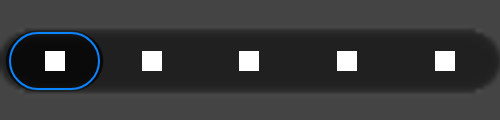

# Tab bar keyboard focus ring (#117)

- **Source:** branch `fix/117-tab-focus-ring`, `GlassTabBar` with `GlassTabBarStyle.Calm()`, the public overload's default.
- **Capture:** `GlassTabBarFocusTest.theSelectedTabsRingIsDrawnOverTheSelector`, desktop JVM software renderer. The scene
  is 500 x 120 dp at density 1, with a dark-grey source behind the bar and white squares as tab content. Focus is
  moved to the selected tab (index 0) with `requestFocus()`.
- **Reproduce:** `./gradlew :liquidglass:jvmTest --tests "*GlassTabBarFocusTest"`. The capture is written to
  `liquidglass/build/reports/atlas/tab-focus-ring.png`.

This is candidate output, not a measurement: iOS's keyboard focus ring was not recorded. The colour is iOS's dark
system blue (0A84FF) and the shape is authored.

Verified by `GlassTabBarFocusTest`:
- **Before focus:** no ring pixels.
- **Focused unselected tab:** a ring (over 200 ring-coloured pixels).
- **Focused selected tab:** a ring drawn over the selector.
- **Keyboard focus, then a mouse click on another tab:** no ring.
- **A mouse click alone:** no ring.

`GlassTabBarGestureTest` still passes.
