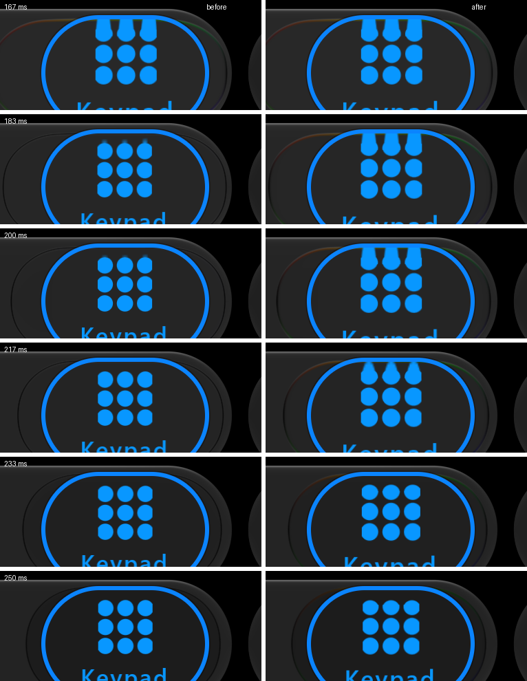

# Calm taps keep the formed lens as they settle (part of #70) — 17 November 2026

Source revision: branch `fix/70-plateau` on main `7fa5ec24`. Backend: desktop JVM, Skia GPU render (`:desktop:phoneReplay`,
`calm`, the full finger scripts of docs/1 (32 s) and JGEY2190 (48 s)). "Before" is this branch with the new behaviour
switched off by the replay's diagnostic option (`calm+tapf=0`); it is within 2 levels of the main baseline render at every
frame of docs/1 and its pose trace is identical. "After" is the branch as shipped. Both were scored against the iOS
recordings, which are private: only numbers measured from them appear here, no iOS frames. Nothing here was captured on a
phone.

## The cause

A Calm tap of two tabs or more moves fast enough to form the selector past half (formation about 0.76; one-tab taps reach
about 0.29). While it is formed past half, its transit fold runs on the formed lens's map (the held family), whose band
stretches the destination's ink into teardrops along the top rim. In the frame its formation fell back below half, the
material switched the fold to the measured map, and the teardrops vanished in one frame. On every one of docs/1's ten
0 to 2 taps, in the main render and in two earlier renders at tap clocks 1.0 and 1.2, the largest one-frame drop of the
level is the frame where the formation crosses 0.5 (183 or 200 ms). So the cliff is not #176's clock; that only set the
frame.

## What changed

A tap that formed the selector past half keeps the formed lens's map in its fold until it settles
(`GlassPoseSpec.tapKeepsFormedLens`, internal, on in Calm). The fold's own strength still follows the transit appearance,
so the teardrops fade as it does. Geometry, formation, the transit appearance and arrival are untouched (the replay traces
are identical). One-tab taps, held lenses, throws and light `Calm` (which has no transit fold) are unchanged. Mirrored in
the Skia and .NET Calm selectors: the controllers expose `tapFormed`, and the material takes `formedTap` (both additive).

*Our renders only (docs/1 replay, the tap at 2.68 s, Keypad at the destination; 167-250 ms after the tap's start). Left:
before. Right: after. The blue ring round the Keypad tab is the keyboard focus ring, which this desktop replay shows from
its first frame on main as well; it is not part of this change.*

## The travelling pill's level, per tap class

Median level at rows 470-490 in a 120 px window on iOS's selected-ink track (`tapprofile.py`'s window, split by class).
These rows read the destination's ink as much as the pill's own pigment, which is what the teardrops change.

docs/1:

| ms | 150 | 167 | 183 | 200 | 217 | 233 | 250 |
| :-- | --: | --: | --: | --: | --: | --: | --: |
| 0 to 2 (10 taps), iOS | 89.5 | 114.3 | 105.7 | 85.7 | 63.5 | 41.3 | 30.1 |
| 0 to 2, before | 82.6 | 114.9 | 38.0 | 37.0 | 36.0 | 32.5 | 27.5 |
| 0 to 2, after | 82.6 | 114.9 | 110.6 | 105.7 | 49.3 | 32.5 | 27.5 |
| 2 to 0 (11 taps), iOS | 53.1 | 55.3 | 56.0 | 50.0 | 45.0 | 39.6 | 34.3 |
| 2 to 0, before | 57.4 | 55.4 | 50.9 | 49.2 | 46.2 | 40.2 | 31.1 |
| 2 to 0, after | 57.4 | 55.4 | 52.8 | 49.6 | 47.2 | 40.2 | 31.1 |

JGEY2190:

| ms | 150 | 167 | 183 | 200 | 217 | 233 | 250 |
| :-- | --: | --: | --: | --: | --: | --: | --: |
| 0 to 2 (10 taps), iOS | 88.2 | 100.3 | 91.4 | 70.6 | 51.3 | 30.1 | 25.0 |
| 0 to 2, before | 113.0 | 109.5 | 38.0 | 37.0 | 36.0 | 33.0 | 28.0 |
| 0 to 2, after | 113.0 | 109.5 | 110.1 | 109.5 | 56.4 | 33.0 | 27.5 |
| 2 to 0 (11 taps), iOS | 56.0 | 53.1 | 52.1 | 49.8 | 45.9 | 40.1 | 35.7 |
| 2 to 0, before | 60.0 | 52.8 | 50.8 | 49.5 | 46.6 | 40.5 | 32.5 |
| 2 to 0, after | 60.0 | 52.8 | 50.8 | 49.8 | 47.5 | 40.5 | 32.4 |

One-tab taps (0 to 1, 1 to 0, 1 to 2, 2 to 1) read the same before and after at every sampled time, on both recordings;
on docs/1 every frame that differs at all lies 183-600 ms after a two-tab tap.

## Where the plateau ends

The end of the 0 to 2 plateau: the time the level falls below half-way between its 167 ms value and its 300 ms value
(linear between frames).

| recording | iOS | before | after |
| :-- | --: | --: | --: |
| docs/1 | 214 ms | 178 ms | 212 ms |
| JGEY2190 | 210 ms | 178 ms | 215 ms |

All-tap median profile (`tapprofile.py`, every tap), 100-300 ms, levels rms against iOS: docs/1 3.3 before, 2.9 after;
JGEY2190 5.7 before, 3.3 after.

What is left: iOS's teardrops fade over about three frames (0 to 2, docs/1: 105.7, 85.7, 63.5 at 183-217 ms); ours hold
full and go within one (110.6, 105.7, 49.3). The teardrops' size depends steeply on the lens's strength (they are nearly
gone once it falls below about 0.9), so a fade cannot be shaped through that strength; see the rejected candidates.

## A five-tab recording (iOS 27, 16 November)

A private iOS 27 recording of a five-tab App Store bar has six taps, including four-tab trips (first to last and back) and
two-tab trips. It was replayed on our App Store scene (`appstore-clear`) with the same finger times. Our scene's page and
icons are placeholders, so the level at rows 470-490 reads content, not the plateau, and is not reported. Looked at frame
by frame: iOS's teardrops on a first-to-last tap and a first-to-middle tap last past 300 ms, and a middle-to-last tap shows
none; ours show a faint top stretch on all three, before and after alike. This change does not move that recording
measurably; the longer trips stay open on #70.

## Rejected candidates

- **Leaving the fold for the held lens's own map below half** (the held branch): the top dots were compressed by the band
  instead of stretched; 0 to 2 at 183 ms read 39.3 (iOS 105.7).
- **Keeping the formed map but fading the lens's strength with the formation** (from 0.5 down to a floor of 0.2, 0.12 or
  0.05): the teardrops held one frame longer and then went in one frame anyway (0 to 2 at 200 ms: 38.2, 42.9, 52.8; iOS
  85.7), because their size depends steeply on that strength. Keeping the strength on the transit appearance is the
  shipped form, and needs no new constant.

## Provenance

- **Measured:** every number in the tables (iOS from the decoded recordings; before and after from our replays), and the
  cause (the per-tap drop frame against the formation's crossing, three renders).
- **Inherited:** the half-formation threshold (0.5), unchanged.
- **Authored:** none. The change keeps an existing map for longer; it adds no fitted constant.
- **Tests:** `GlassPhoneTapOpticsTest` gains two: a two-slot tap (both directions) keeps the formed lens's family from the
  frame it forms past half until it settles and never loses more than 0.4 of its lens strength in one 60 Hz frame (fails
  with main's switch: the family turns measured at the crossing); one-slot taps and light Calm give the same material with
  the option on and off. The port fixtures record `tapFormed` per frame and eight formed-tap material samples per
  appearance; `ports/skia` `npm test` 46/46 and the .NET checks 16/16 reproduce them.

## Limits

- Desktop replay only; no Pixel look.
- Trips of three tabs or more are unchecked against a recording beyond the five-tab look above.
