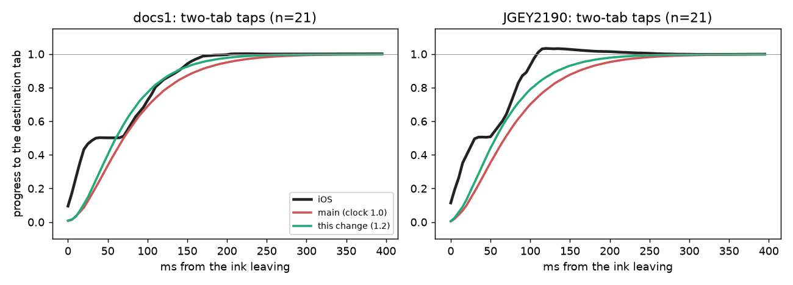

# Two-tab taps arrive on time (#70) — 2 November 2026

Our frames only: desktop JVM GPU replay (`:desktop:phoneReplay`, `calm`, each recording's full `script3.txt`: docs/1
32 s, JGEY2190 48 s), the selector's centre from the replay trace. iOS's curve is its selected ink's position from the
decoded recording (`track.csv`), not reproduced here. Each tap is normalised so 0 is its start tab and 1 its
destination; the curves are medians over the 21 two-tab taps of each recording.

## Measured

When the selector (ours) or the selected ink (iOS) comes within 20 px of the destination tab, measured from the ink
leaving (`taparrive.py`), median over each recording's taps, ours minus iOS:

| clock for two-slot trips | docs/1 two-tab (n = 21) | JGEY2190 two-tab (n = 21) | one-tab taps |
| --: | --: | --: | --: |
| 1.0 (main) | +39 ms | +98 ms | unchanged |
| 1.1 | +23 ms | +82 ms | unchanged |
| 1.15 | +20 ms | +70 ms | unchanged |
| **1.2 (this change)** | **+6 ms** | **+65 ms** | unchanged |

iOS arrives at 170 ms (docs/1) and 117 ms (JGEY2190); ours at 220 ms on main, 190 and 187 ms with this change.

## The change (Calm only)

`GlassPoseSpec.Calm` gains an internal `tapLongTripRate` of 1.2: the coupled tap's clock runs 1.2× for a two-slot trip,
blending from the one-slot rate (0.75, unchanged) and back to the historical clock by three slots, a distance no
recording measures (the recordings' bars have three tabs). One-slot taps are untouched. Mirrored in the Skia and .NET
ports' Calm selectors. No public API change.

## Limits

- JGEY2190's taps stay ~65 ms late: from 1.15 up its arrival barely moves (187 ms), so the rest is not the clock. Its
  iOS ink also overshoots the destination (to 1.03) where ours does not.
- The one-tab gap (+172 ms against iOS's ink) compares ink that stops at a tab with a lens that presses on; it is not
  a like-for-like timing and is not changed here.
- Desktop replay only; the arrival is a timing in the shared pose model, which Android runs unchanged.

## On a device

Pixel 7 (Android 17, 90 Hz), release builds of the sample's `PhoneActivity` (dark), 2 November: ten two-tab taps
alternating Keypad (677, 2200) and Calls (218, 2200), 1.4 s apart, recorded with `adb shell screenrecord` (~38 fps).
On the phone the selected ink is blue and the lens re-inks what it covers, so the blue centroid in the bar follows the
lens. Time from it leaving its start tab (> 25 px) to within 20 px of the other tab:

| build | taps | arrival (ms) | median |
| :-- | --: | :-- | --: |
| main | 10 | 134 133 136 145 132 134 144 133 132 122 | 134 |
| this change | 10 | 111 111 122 122 111 110 110 112 112 111 | 111 |

About 23 ms sooner, as on the replay. This measures the ink's travel, which starts after the selector's, so its
absolute times are shorter than the replay's selector arrival; the difference is what the change makes.
