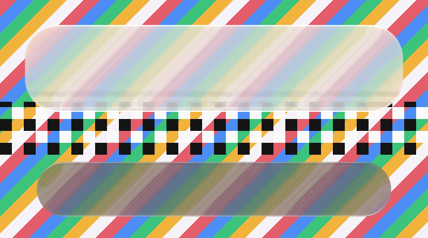

# Unity: 20 October 2026

`ports/unity/com.shayxo.liquidglass` is the liquidglass material as a Unity shader (Built-in and URP)
with a `GlassSurface` component. **Unity is not installed where it was written, so nothing here is a
Unity capture.** What could be checked without Unity was checked by `ports/unity/Checks`.

*Our render: `dotnet run --project ports/unity/Checks`, on Windows 11's D3D11 WARP software device,
720 × 400, density 2. The generated `LiquidGlassMaterial.hlsl` and `LiquidGlassScreen.hlsl`, compiled by
FXC (`d3dcompiler_47`) as `ps_5_0`, draw a light card (radius 28 dp, overhead light) and a dark bar
(radius 24 dp) over the [backdrop](unity-backdrop.png). The checker row bends where it passes under the
card's lower rim. The check passes when the glass changes the pixels under it, is not a flat fill, the
bar is darker than the backdrop under it, the card stays light, and pixels outside are untouched.*

## Limits

- Not run in Unity: the ShaderLab wrappers (`LiquidGlass.shader`, `LiquidGlassURP.shader`), GrabPass,
  URP's opaque texture, UI canvases and `GlassSurface.cs` are unverified.
- One compiler and back end: FXC and Direct3D 11 (WARP). Unity's Vulkan, Metal and OpenGL ES paths
  translate FXC's output with HLSLcc and are not exercised.
- The screen mapping is exercised with an axis-aligned quad only.
