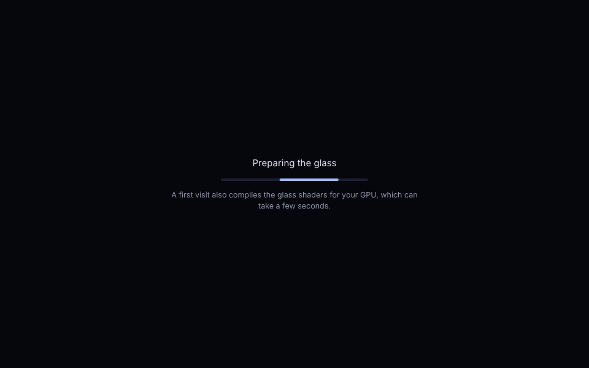
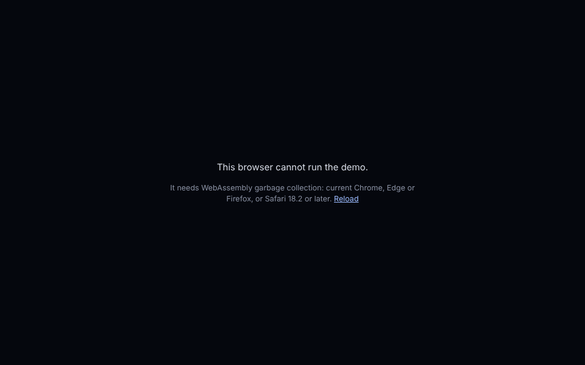
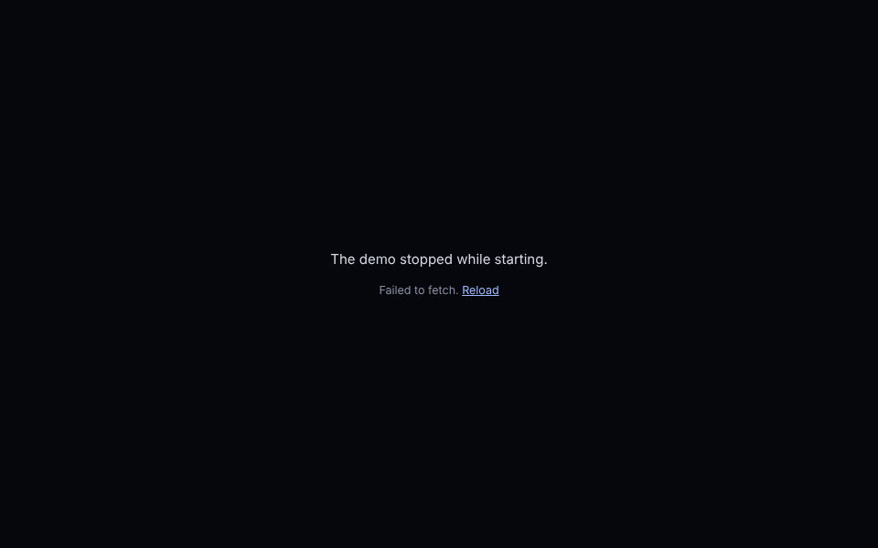
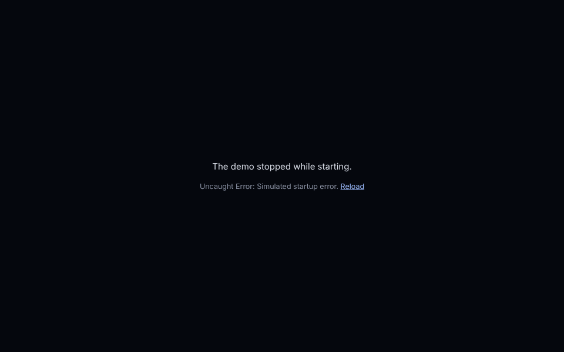
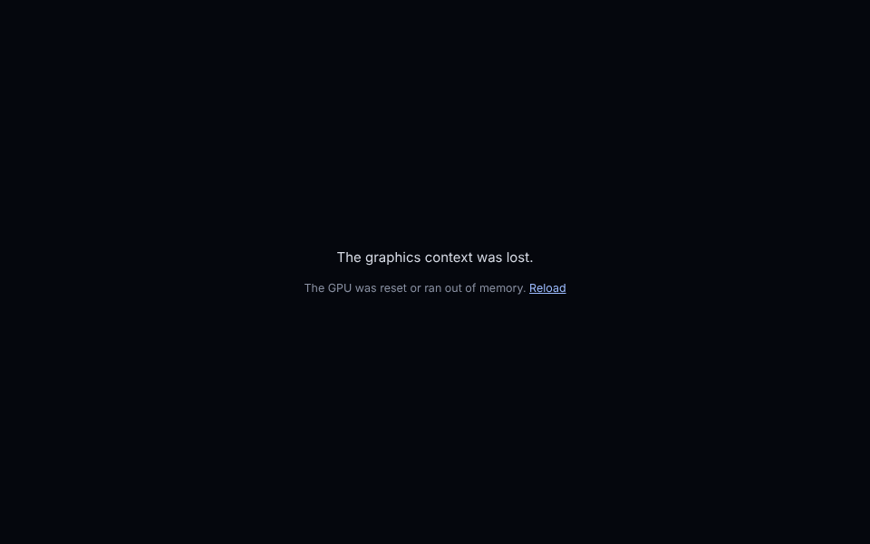

# The web demo's first load, part 2 (#78) — 24 October 2026

The [20 October record](../web-demo-load-2026-10-20/README.md) put a loader and on-page failures in front
of the first load but left the time to a usable app unchanged: the download (4.46 MB gzip) plus the
first-visit shader compilation. This round tried the code-side options the issue lists. One change is
kept: **both WebAssembly downloads now start with the page**. It saves 0.3-0.35 s on 4G and nothing
measurable unthrottled. The shader compilation could not be measured on this machine, so nothing was
changed there (see [Not done](#not-done-and-why)).

## What changed

- **Preloading the two `.wasm` files.** Before, the page downloaded `atlas.js` first, and only once
  `atlas.js` had downloaded and run did it ask for Skia's runtime (3.28 MB gzip) and the app (1.08 MB).
  The two then downloaded in parallel. Now a script in the page's head adds a `<link rel="preload"
  as="fetch" crossorigin>` for each, so both downloads start together with `atlas.js`.
  - The file names are content hashes, so `apps/web/build.gradle.kts` writes them into the built
    `index.html` after `wasmJsBrowserDistribution`. The build fails if a `.wasm` file or the placeholder
    is missing.
  - `crossorigin` matches the generated loader's same-origin `fetch`, so the browser reuses the
    preloaded responses rather than downloading them twice (4469 kB transferred, before and after).
  - The preloads are added only where WebAssembly GC validates, which is the same check the loader
    already made, now in the head and shared. A browser that cannot run the demo still downloads
    nothing (0 `.wasm` requests).
- **Already in place, no change needed:** the generated loaders already use
  `WebAssembly.instantiateStreaming` for both modules, so compilation overlaps the download.
- **Tools.** [`tools/measure_web_demo.mjs`](../../../tools/measure_web_demo.mjs) gained page-clock marks.
  The main thread can be busy for seconds, which makes polling and screenshots lag, so the marks are
  recorded in the page itself:
  - `first paint`: the first contentful paint, which is the loader.
  - `started`: the app's `main()` ran.
  - `context`: Skia's runtime had loaded and made its first WebGL context, so the whole download is in.
  - `ready`: the loader was dismissed after settled frames.

  Since the measurements below were taken, `context` is recorded after `getContext` returns a WebGL
  context rather than when it is called (CodeRabbit review on PR #91). The tables used the earlier
  version for both builds alike, so the before/after comparison is unaffected; absolute `context` times
  may move by the context's creation time.

  It also gained the start time of each request, `MEASURE_UNTIL`, `MEASURE_TIMEOUT_S`, and
  `MEASURE_CHANNEL=bundled` for a machine without Chrome.
  [`tools/web_demo_states.mjs`](../../../tools/web_demo_states.mjs) forces the five loader states and
  screenshots them.

## Measurements

`node tools/measure_web_demo.mjs <dist>#material3 5 <none|fast4g|slow4g>` with `MEASURE_CHANNEL=bundled
MEASURE_UNTIL=context`. Setup:
- The script serves the build as GitHub Pages does (gzip, `max-age=600`).
- Each run uses a fresh browser, so caches are cold.
- Linux cloud container, 4 vCPU, Playwright's Chromium (build 1243), headless, **software GL** (no GPU).
- Throttling is CDP network emulation.
- *Before* is `main` at `e5b90b3`; *after* is this branch. Both are built the same way. Medians of 5
  runs, page clock in ms from navigation; raw output is in [`raw/`](raw/).

| Network | Downloads start (before → after) | `started` (before → after) | **`context`: download in, Skia ready** (before → after) | Change |
| :-- | --: | --: | --: | --: |
| none (local) | ~105 → ~18 | 525 → 183 | **562 → 511** | −51 ms (within run spread 482-630) |
| fast 4G (9 Mbit/s, 40 ms) | ~257 → ~56 | 2629 → 1956 | **4603 → 4262** | **−341 ms (−7%)** |
| slow 4G (1.6 Mbit/s, 150 ms) | ~900 → ~166 | 12400 → 11839 | **23635 → 23283** | **−352 ms (−1.5%)** |

- First paint (the loader) is unchanged: 28-36 / 64-76 / 176-192 ms after, against 28-32 / 64-68 /
  180-184 ms before (3 runs each, [`raw/first-paint.txt`](raw/first-paint.txt)). The tool's polled
  `loader=` value moves more than that between runs. It is sampled every 100 ms from outside a busy
  page, so it is not a paint time.
- A first variant wrote the links into the page as static `<link>` tags. It measured the same (536 /
  4316 / 23295 ms), but it downloaded 4.5 MB even in a browser without WebAssembly GC, so it was replaced
  ([`raw/before-and-static-preload.txt`](raw/before-and-static-preload.txt), "after").
- Transfer: 4468 kB before, 4469 kB after. Nothing is downloaded twice.

The saving is the time the downloads used to wait for `atlas.js`. The connection still has to carry
the same 4.4 MB, so on a slow link the gain is a small share of the total.

## The page's states, after this change

`node tools/web_demo_states.mjs <dist> <out>`, Playwright's Chromium, 960 × 600, local build of this
branch. The before build gives the same states, texts and request counts.

| State | Loader result | `.wasm` requests |
| :-- | :-- | --: |
| loading (300 ms in) | "Preparing the glass" | 2 |
| no WebAssembly GC (`WebAssembly.validate` stubbed) | "This browser cannot run the demo." | **0** |
| download failed (every `.wasm` request aborted) | "The demo stopped while starting. Failed to fetch." | 3 (the preload, then the loader's own fetch) |
| uncaught error while starting | "The demo stopped while starting. Uncaught Error: …" | 2 |
| WebGL context lost after the canvas exists | "The graphics context was lost." | 2 |

| Loading | No WebAssembly GC |
| :-: | :-: |
|  |  |
| **Download failed** | **Startup error** |
|  |  |
| **Graphics context lost** | |
|  | |

*Playwright's Chromium 1243, software GL, 960 × 600, this branch's build served locally without
compression. The failure states are forced as listed above; they are not real old browsers or GPU resets.*

## Not done, and why

- **Warming the glass shaders on a tiny offscreen surface, deferring offscreen panels, trimming the
  opening scene.** These target the ~2 s-per-frame shader compilation measured on 20 October on a
  laptop GPU. That cannot be measured here: under software GL every glass frame takes 8-10 s whether
  or not it compiles anything (longest gaps 7.4-10.6 s), so no run reaches `ready` within 60-240 s
  before or after. A warm-up would also run the same compilations, only earlier; #71 found that pattern
  on Android. Changing the opening scene would also change `LoupeScreen`/`MaterialShowcase`, which the
  Android and desktop apps share. They need a run on a machine with a GPU (the owner's laptop, with
  `MEASURE_CHANNEL` unset and no `MEASURE_UNTIL`).
- **Smaller transfers (owner's decision, not set up):** GitHub Pages serves gzip only. Brotli at quality 11
  on the same files gives 3.53 MB instead of 4.53 MB (gzip -6), 22% less: Skia's runtime 2.62 vs 3.34 MB,
  the app 0.82 vs 1.10 MB, `atlas.js` 0.08 vs 0.10 MB. On slow 4G that is roughly 5 s of the 23 s. It
  needs a host or CDN that serves pre-compressed `.br` files with `Content-Encoding: br` (for example
  Cloudflare in front of Pages, or Netlify/Cloudflare Pages for `/demo/`). That is a hosting and DNS
  change for the owner.

## Limits

- One machine, one engine, software GL. The network numbers are emulated, and the absolute times (and
  `started`/`context` on a fast machine with a GPU) will differ. Before and after were measured
  alternately on the same machine in the same session.
- Time to a usable app (`ready`) was not measured: it is dominated here by software rendering. The
  change only moves the download earlier and cannot slow the frames after it, but the saving as a
  share of a real first visit is unmeasured.
- Building the demo in this container needed a machine-local workaround: the Kotlin/Wasm tooling's
  `karma` fork is fetched from codeload.github.com, which this sandbox blocks, so it was installed from
  a git clone. Nothing about it is in the repository; CI builds the demo as before.
